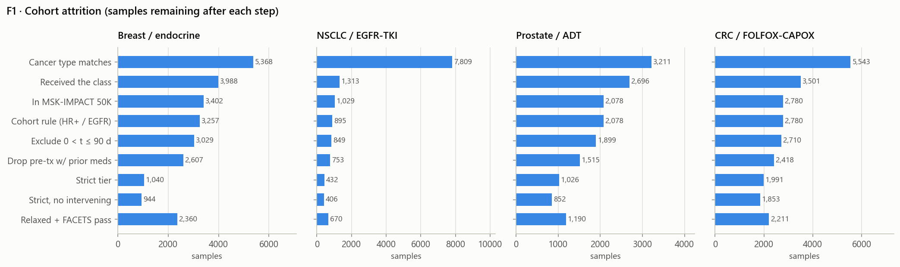
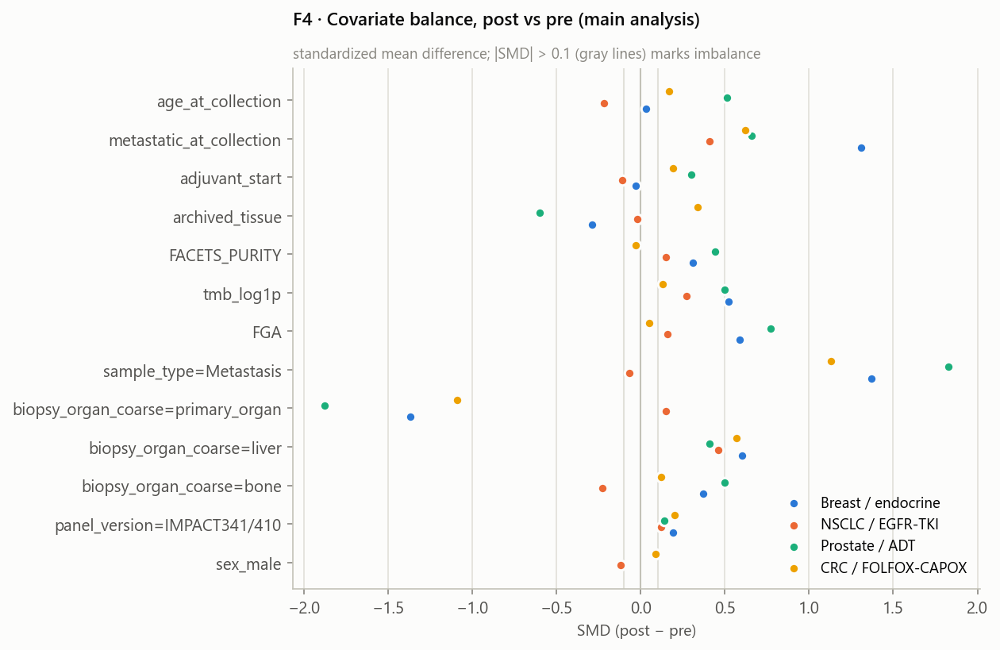
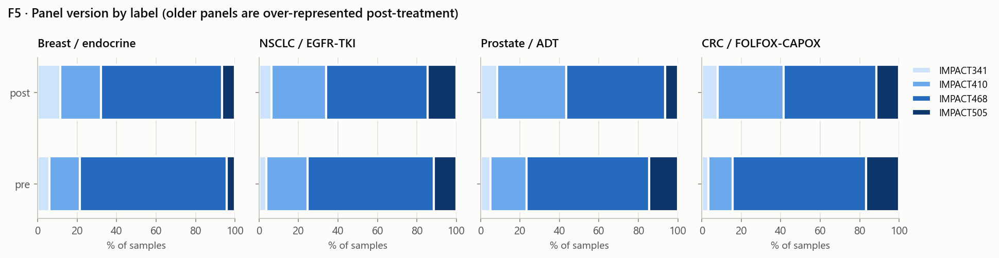
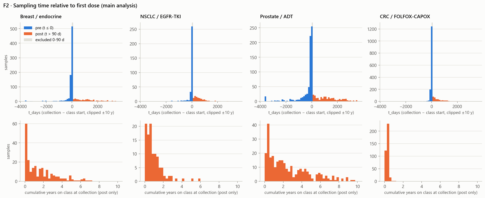
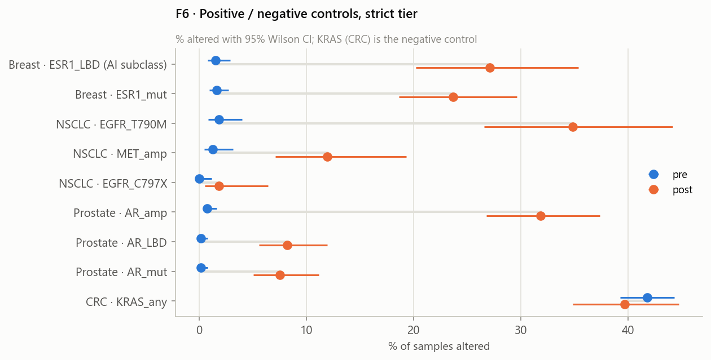

# Data cleaning report (data_cleaning_plan.md v3, milestones M1-M2)

Generated by `data/report.py`. All counts come from the pipeline outputs in `data/derived/`.
Pre = sample collected on or before the first dose of the cohort's drug class (label 0);
post = collected more than 90 days after it (label 1). Main analysis = strict tier minus
hypermutated samples.

## T1 · Cohort attrition

| step | description | Breast / endocrine | NSCLC / EGFR-TKI | Prostate / ADT | CRC / FOLFOX-CAPOX |
|---|---|---|---|---|---|
| 0 | MSK-CHORD samples with a collection date | 25040 | 25040 | 25040 | 25040 |
| 1 | sample cancer type matches cohort | 5368 | 7809 | 3211 | 5543 |
| 2 | patient received the class after primary diagnosis | 3988 | 1313 | 2696 | 3501 |
| 3 | sample in MSK-IMPACT 50K with mutation + CNA data | 3402 | 1029 | 2078 | 2780 |
| 4 | breast: HR-positive (HR == 'Yes') | 3257 | <NA> | <NA> | <NA> |
| 4 | nsclc: EGFR-sensitizing alteration (ex19del, L858R, G719X, L861Q, S768I, E709X) | <NA> | 895 | <NA> | <NA> |
| 4 | no cohort-specific rule | <NA> | <NA> | 2078 | 2780 |
| 4L | labelled (all t) | 3257 (818 post) | 895 (192 post) | 2078 (501 post) | 2780 (497 post) |
| 5 | exclude 0 < t_days <= 90 (and unlabelled) | 3029 (818 post) | 849 (192 post) | 1899 (501 post) | 2710 (497 post) |
| 5b | exclude label-0 samples with prior medications to MSK | 2607 (818 post) | 753 (192 post) | 1515 (501 post) | 2418 (497 post) |
| 5c | one sample per patient | 2607 (818 post) | 753 (192 post) | 1515 (501 post) | 2418 (497 post) |
| 6 | strict tier: class first-line, no prior meds to MSK, FACETS QC pass | 1040 (234 post) | 432 (109 post) | 1026 (299 post) | 1991 (387 post) |
| 6b | strict, no intervening therapy | 944 (138 post) | 406 (83 post) | 852 (125 post) | 1853 (249 post) |
| 7 | relaxed tier with FACETS QC pass (clonality available) | 2360 (770 post) | 670 (176 post) | 1190 (408 post) | 2211 (450 post) |

### Section 2.1 reproduction (loose cohort, before the MSK-IMPACT filter)

| cohort | samples | t_le_0 | t_0_90 | t_gt_90 | t_gt_90_on_class | strict_t_le_0 | strict_t_gt_90 | strict_t_gt_90_no_between | median_t_gt_90 |
|---|---:|---:|---:|---:|---:|---:|---:|---:|---:|
| breast | 3,988 | 2,655 | 287 | 1,046 | 615 | 847 | 245 | 145 | 1.16e+03 |
| nsclc | 1,313 | 975 | 72 | 266 | 200 | 346 | 117 | 87 | 556 |
| prostate | 2,696 | 1,853 | 242 | 601 | 450 | 727 | 299 | 125 | 1.01e+03 |
| crc | 3,501 | 2,819 | 84 | 598 | 57 | 1,604 | 387 | 249 | 350 |

## T2 · Cohort characteristics (main analysis)

| cohort | variable | pre | post | SMD |
|---|---|---|---|---:|
| Breast / endocrine | n | 800 | 228 |  |
| Breast / endocrine | age_at_collection | 58.79 | 59.20 | 0.03 |
| Breast / endocrine | metastatic_at_collection | 36.0% | 89.0% | 1.31 |
| Breast / endocrine | adjuvant_start | 60.2% | 58.8% | -0.03 |
| Breast / endocrine | archived_tissue | 15.5% | 6.6% | -0.29 |
| Breast / endocrine | FACETS_PURITY | 0.43 | 0.49 | 0.31 |
| Breast / endocrine | tmb_log1p | 1.29 | 1.60 | 0.52 |
| Breast / endocrine | FGA | 0.13 | 0.24 | 0.59 |
| Breast / endocrine | n_prior_classes | 0.00 | 0.00 |  |
| Breast / endocrine | sample_type=Metastasis | 20.5% | 77.2% | 1.37 |
| Breast / endocrine | biopsy_organ_coarse=primary_organ | 79.8% | 23.2% | -1.37 |
| Breast / endocrine | biopsy_organ_coarse=liver | 3.2% | 22.4% | 0.6 |
| Breast / endocrine | biopsy_organ_coarse=bone | 6.5% | 18.4% | 0.37 |
| Breast / endocrine | panel_version=IMPACT341/410 | 6.0% | 11.4% | 0.19 |
| NSCLC / EGFR-TKI | n | 323 | 109 |  |
| NSCLC / EGFR-TKI | age_at_collection | 65.67 | 63.14 | -0.22 |
| NSCLC / EGFR-TKI | sex_male | 31.0% | 25.7% | -0.12 |
| NSCLC / EGFR-TKI | metastatic_at_collection | 84.5% | 96.3% | 0.41 |
| NSCLC / EGFR-TKI | adjuvant_start | 10.5% | 7.3% | -0.11 |
| NSCLC / EGFR-TKI | archived_tissue | 2.2% | 1.8% | -0.02 |
| NSCLC / EGFR-TKI | FACETS_PURITY | 0.37 | 0.37 | 0.15 |
| NSCLC / EGFR-TKI | tmb_log1p | 1.60 | 1.68 | 0.27 |
| NSCLC / EGFR-TKI | FGA | 0.20 | 0.21 | 0.16 |
| NSCLC / EGFR-TKI | n_prior_classes | 0.00 | 0.00 |  |
| NSCLC / EGFR-TKI | sample_type=Metastasis | 55.1% | 51.4% | -0.07 |
| NSCLC / EGFR-TKI | biopsy_organ_coarse=primary_organ | 45.5% | 53.2% | 0.15 |
| NSCLC / EGFR-TKI | biopsy_organ_coarse=liver | 2.2% | 14.7% | 0.46 |
| NSCLC / EGFR-TKI | biopsy_organ_coarse=bone | 9.3% | 3.7% | -0.23 |
| NSCLC / EGFR-TKI | panel_version=IMPACT341/410 | 3.7% | 6.4% | 0.12 |
| Prostate / ADT | n | 704 | 292 |  |
| Prostate / ADT | age_at_collection | 65.12 | 69.63 | 0.51 |
| Prostate / ADT | metastatic_at_collection | 64.5% | 90.8% | 0.66 |
| Prostate / ADT | adjuvant_start | 26.3% | 40.1% | 0.3 |
| Prostate / ADT | archived_tissue | 32.8% | 9.2% | -0.6 |
| Prostate / ADT | FACETS_PURITY | 0.43 | 0.56 | 0.44 |
| Prostate / ADT | tmb_log1p | 1.09 | 1.37 | 0.5 |
| Prostate / ADT | FGA | 0.10 | 0.23 | 0.77 |
| Prostate / ADT | n_prior_classes | 0.00 | 0.00 |  |
| Prostate / ADT | sample_type=Metastasis | 18.8% | 86.3% | 1.83 |
| Prostate / ADT | biopsy_organ_coarse=primary_organ | 81.5% | 13.0% | -1.88 |
| Prostate / ADT | biopsy_organ_coarse=liver | 0.9% | 9.9% | 0.41 |
| Prostate / ADT | biopsy_organ_coarse=bone | 5.1% | 21.6% | 0.5 |
| Prostate / ADT | panel_version=IMPACT341/410 | 5.0% | 8.6% | 0.14 |
| CRC / FOLFOX-CAPOX | n | 1,479 | 373 |  |
| CRC / FOLFOX-CAPOX | age_at_collection | 55.65 | 57.62 | 0.17 |
| CRC / FOLFOX-CAPOX | sex_male | 53.5% | 58.2% | 0.09 |
| CRC / FOLFOX-CAPOX | metastatic_at_collection | 59.6% | 85.8% | 0.62 |
| CRC / FOLFOX-CAPOX | adjuvant_start | 36.6% | 45.8% | 0.19 |
| CRC / FOLFOX-CAPOX | archived_tissue | 10.6% | 23.1% | 0.34 |
| CRC / FOLFOX-CAPOX | FACETS_PURITY | 0.44 | 0.43 | -0.03 |
| CRC / FOLFOX-CAPOX | tmb_log1p | 1.93 | 1.97 | 0.13 |
| CRC / FOLFOX-CAPOX | FGA | 0.18 | 0.19 | 0.05 |
| CRC / FOLFOX-CAPOX | n_prior_classes | 0.00 | 0.00 |  |
| CRC / FOLFOX-CAPOX | sample_type=Metastasis | 15.1% | 63.3% | 1.13 |
| CRC / FOLFOX-CAPOX | biopsy_organ_coarse=primary_organ | 85.0% | 38.3% | -1.09 |
| CRC / FOLFOX-CAPOX | biopsy_organ_coarse=liver | 9.3% | 31.4% | 0.57 |
| CRC / FOLFOX-CAPOX | biopsy_organ_coarse=bone | 0.4% | 1.6% | 0.12 |
| CRC / FOLFOX-CAPOX | panel_version=IMPACT341/410 | 3.4% | 8.0% | 0.2 |

## T3 · Exposure summary (main analysis, post-treatment samples)

| cohort | post n | t_days median [IQR] | cum_days_on_class median [IQR] | % on class at collection | % with intervening lines | most common intervening classes | % adjuvant start (all) |
|---|---:|---|---|---|---|---|---|
| Breast / endocrine | 228 | 1134 [516-1928] | 412 [82-918] | 58% | 41% | fluoropyrimidine (45), other_chemo (34), pi3k_mtor (33) | 60% |
| NSCLC / EGFR-TKI | 109 | 511 [272-804] | 266 [122-495] | 76% | 24% | other_chemo (14), investigational (10), platinum (10) | 10% |
| Prostate / ADT | 292 | 1358 [696-2466] | 719 [234-1517] | 77% | 59% | ar_inhibitor (143), taxane (49), investigational (42) | 30% |
| CRC / FOLFOX-CAPOX | 373 | 447 [214-916] | 100 [85-126] | 7% | 35% | fluoropyrimidine (89), irinotecan (71), anti_vegf (36) | 38% |

## T4 · Positive / negative controls through the pipeline

`raw_plan_denominator` reproduces the plan's Section 2.2 numbers, which divided by all loose
samples including ~22% with no MSK-IMPACT genomics. Every later stage uses profiled samples only.

| cohort | control | raw_plan_denominator | raw | onco_filter | panel_mask | relaxed | strict | strict_noint | S3_survivorship_strict | A-on_strict |
|---|---|---|---|---|---|---|---|---|---|---|
| breast | ESR1 mutation | 2.6% → 14.3% (n=2,655/1,046) | 3.0% → 18.0% (n=2,329/835) | 1.4% → 16.3% (n=1,789/818) | 1.4% → 16.3% (n=1,789/818) |  |  |  |  |  |
| breast | ESR1_LBD (AI subclass) |  |  |  | 1.3% → 18.2% (n=1,251/462) | 1.3% → 18.2% (n=1,251/462) | 1.5% → 27.1% (n=588/129) | 1.5% → 24.3% (n=588/74) | 1.6% → 27.1% (n=425/129) | 1.5% → 27.6% (n=588/76) |
| breast | ESR1_mut |  |  |  |  | 1.4% → 16.3% (n=1,789/818) | 1.6% → 23.7% (n=800/228) | 1.6% → 15.7% (n=800/134) | 1.5% → 23.7% (n=585/228) | 1.6% → 25.0% (n=800/132) |
| crc | KRAS mutation | 35.7% → 38.3% (n=2,819/598) | 45.5% → 46.1% (n=2,213/497) | 40.9% → 41.9% (n=1,921/497) | 40.9% → 41.9% (n=1,921/497) |  |  |  |  |  |
| crc | KRAS_any |  |  |  |  | 40.9% → 41.9% (n=1,921/497) | 41.8% → 39.7% (n=1,479/373) | 41.8% → 43.2% (n=1,479/241) | 40.4% → 39.7% (n=1,249/373) | 41.8% → 57.7% (n=1,479/26) |
| nsclc | EGFR C797S | 0.2% → 1.5% (n=975/266) | 0.3% → 1.9% (n=771/211) | 0.0% → 2.1% (n=561/192) | 0.0% → 2.1% (n=561/192) |  |  |  |  |  |
| nsclc | EGFR T790M | 1.5% → 27.1% (n=975/266) | 1.9% → 34.1% (n=771/211) | 1.8% → 37.5% (n=561/192) | 1.8% → 37.5% (n=561/192) |  |  |  |  |  |
| nsclc | EGFR_C797X |  |  |  |  | 0.0% → 2.1% (n=561/192) | 0.0% → 1.8% (n=323/109) | 0.0% → 1.2% (n=323/83) | 0.0% → 1.8% (n=240/109) | 0.0% → 1.2% (n=323/83) |
| nsclc | EGFR_T790M |  |  |  |  | 1.8% → 37.5% (n=561/192) | 1.9% → 34.9% (n=323/109) | 1.9% → 34.9% (n=323/83) | 1.3% → 34.9% (n=240/109) | 1.9% → 28.9% (n=323/83) |
| nsclc | MET amplification | 0.8% → 7.1% (n=975/266) | 1.0% → 9.0% (n=771/211) | 0.9% → 9.9% (n=561/192) | 0.9% → 9.9% (n=561/192) |  |  |  |  |  |
| nsclc | MET_amp |  |  |  |  | 0.9% → 9.9% (n=561/192) | 1.2% → 11.9% (n=323/109) | 1.2% → 13.3% (n=323/83) | 1.3% → 11.9% (n=240/109) | 1.2% → 15.7% (n=323/83) |
| prostate | AR amplification | 1.3% → 29.1% (n=1,853/601) | 1.7% → 34.9% (n=1,398/501) | 0.8% → 34.9% (n=1,014/501) | 0.8% → 34.9% (n=1,014/501) |  |  |  |  |  |
| prostate | AR mutation | 0.8% → 8.5% (n=1,853/601) | 1.1% → 10.2% (n=1,398/501) | 0.4% → 8.2% (n=1,014/501) | 0.4% → 8.2% (n=1,014/501) |  |  |  |  |  |
| prostate | AR_LBD |  |  |  |  | 0.3% → 8.6% (n=1,014/501) | 0.1% → 8.2% (n=704/292) | 0.1% → 6.6% (n=704/121) | 0.2% → 8.2% (n=493/292) | 0.1% → 8.8% (n=704/226) |
| prostate | AR_amp |  |  |  |  | 0.8% → 34.9% (n=1,014/501) | 0.7% → 31.8% (n=704/292) | 0.7% → 16.5% (n=704/121) | 0.4% → 31.8% (n=493/292) | 0.7% → 36.7% (n=704/226) |
| prostate | AR_mut |  |  |  |  | 0.4% → 8.2% (n=1,014/501) | 0.1% → 7.5% (n=704/292) | 0.1% → 4.1% (n=704/121) | 0.2% → 7.5% (n=493/292) | 0.1% → 8.0% (n=704/226) |

Mutational-signature checks (Section 9.7, samples with ≥ 10 mutations; not model features):

| cohort | signature | n_pre | n_post | mean_pre | mean_post | pct_dominant_pre | pct_dominant_post |
|---|---|---:|---:|---:|---:|---:|---:|
| crc | Signature 17 (5-FU) | 421 | 109 | 0.0095 | 0.0534 | 1.43 | 10.1 |
| breast | APOBEC (2+13) | 77 | 124 | 0.57 | 0.584 | 83.1 | 79.8 |

## T5 · Alteration prevalence (top 15 by post − pre difference, Firth-eligible features)

| index | Breast / endocrine | NSCLC / EGFR-TKI | Prostate / ADT | CRC / FOLFOX-CAPOX |
|---|---:|---:|---:|---:|
| kept by prevalence filter (Firth list) | 286 | 268 | 262 | 279 |
| main-analysis features | 887 | 488 | 760 | 931 |

| cohort | feature | block | % pre | % post | n altered (main) |
|---|---|---|---:|---:|---:|
| Breast / endocrine | GAB2_loh | alteration | 15.4 | 57.1 | 12 |
| Breast / endocrine | MTAP_loh | alteration | 21.2 | 60 | 16 |
| Breast / endocrine | BAP1_loh | alteration | 20.1 | 42.6 | 245 |
| Breast / endocrine | ESR1_mut | alteration | 1.6 | 23.7 | 67 |
| Breast / endocrine | ESR1_LBD | variant_target | 1.6 | 23.7 | 67 |
| Breast / endocrine | FOXP1_loh | alteration | 17.6 | 39.5 | 220 |
| Breast / endocrine | PBRM1_loh | alteration | 19.5 | 41 | 239 |
| Breast / endocrine | ATM_loh | alteration | 40.3 | 61.4 | 451 |
| Breast / endocrine | DUSP4_loh | alteration | 33.5 | 54 | 287 |
| Breast / endocrine | SDHD_loh | alteration | 41.8 | 62.3 | 467 |
| Breast / endocrine | MST1_loh | alteration | 19.9 | 40.1 | 221 |
| Breast / endocrine | RYBP_loh | alteration | 17 | 37.1 | 209 |
| Breast / endocrine | PPP4R2_loh | alteration | 15.6 | 35.6 | 148 |
| Breast / endocrine | MST1R_loh | alteration | 20.4 | 40.3 | 224 |
| Breast / endocrine | KMT2A_loh | alteration | 42.3 | 61.9 | 465 |
| NSCLC / EGFR-TKI | EGFR_T790M | variant_target | 1.9 | 34.9 | 44 |
| NSCLC / EGFR-TKI | MST1R_loh | alteration | 47.2 | 68.7 | 210 |
| NSCLC / EGFR-TKI | MST1_loh | alteration | 46.5 | 68 | 209 |
| NSCLC / EGFR-TKI | BAP1_loh | alteration | 47.3 | 65.4 | 215 |
| NSCLC / EGFR-TKI | PBRM1_loh | alteration | 46.2 | 64.1 | 211 |
| NSCLC / EGFR-TKI | PPP4R2_loh | alteration | 42.9 | 60.6 | 140 |
| NSCLC / EGFR-TKI | PTPRS_loh | alteration | 45.1 | 61 | 206 |
| NSCLC / EGFR-TKI | SETD2_loh | alteration | 45.5 | 61.3 | 210 |
| NSCLC / EGFR-TKI | VHL_loh | alteration | 43.3 | 58.8 | 189 |
| NSCLC / EGFR-TKI | TGFBR2_loh | alteration | 45.3 | 60.2 | 208 |
| NSCLC / EGFR-TKI | TCF3_loh | alteration | 47.8 | 62.1 | 202 |
| NSCLC / EGFR-TKI | MLH1_loh | alteration | 45.6 | 59.8 | 210 |
| NSCLC / EGFR-TKI | FOXP1_loh | alteration | 43.4 | 57.6 | 192 |
| NSCLC / EGFR-TKI | MAP2K2_loh | alteration | 46.2 | 60 | 208 |
| NSCLC / EGFR-TKI | MTAP_loh | alteration | 33.3 | 46.7 | 19 |
| Prostate / ADT | AR_amp | variant_target | 0.7 | 31.8 | 98 |
| Prostate / ADT | TP53_loh | alteration | 32.5 | 50.8 | 347 |
| Prostate / ADT | MAP2K4_loh | alteration | 24.5 | 42.6 | 286 |
| Prostate / ADT | GPS2_loh | alteration | 31.6 | 48.9 | 302 |
| Prostate / ADT | AURKB_loh | alteration | 30.5 | 47.4 | 336 |
| Prostate / ADT | FAT1_loh | alteration | 10.2 | 26.8 | 144 |
| Prostate / ADT | SMAD4_loh | alteration | 24.7 | 41.2 | 285 |
| Prostate / ADT | BCL2_loh | alteration | 28 | 44.4 | 310 |
| Prostate / ADT | PMAIP1_loh | alteration | 28 | 44.4 | 311 |
| Prostate / ADT | PIK3R1_loh | alteration | 23.9 | 39.6 | 271 |
| Prostate / ADT | ALOX12B_loh | alteration | 32 | 47.8 | 345 |
| Prostate / ADT | ZFHX3_loh | alteration | 38.2 | 53.2 | 365 |
| Prostate / ADT | RB1_loh | alteration | 45.5 | 60.5 | 475 |
| Prostate / ADT | MALT1_loh | alteration | 27.3 | 42.2 | 281 |
| Prostate / ADT | FBXW7_loh | alteration | 5.1 | 19.8 | 89 |
| CRC / FOLFOX-CAPOX | ALB_loh | alteration | 35.5 | 51.2 | 109 |
| CRC / FOLFOX-CAPOX | ZRSR2_loh | alteration | 53.7 | 67 | 631 |
| CRC / FOLFOX-CAPOX | EIF1AX_loh | alteration | 54.2 | 66 | 656 |
| CRC / FOLFOX-CAPOX | MTAP_loh | alteration | 26.1 | 37.2 | 80 |
| CRC / FOLFOX-CAPOX | KMT2B_loh | alteration | 11 | 22.1 | 183 |
| CRC / FOLFOX-CAPOX | NFKBIA_loh | alteration | 33.8 | 44.6 | 628 |
| CRC / FOLFOX-CAPOX | CRLF2_loh | alteration | 55 | 65.3 | 678 |
| CRC / FOLFOX-CAPOX | KDM6A_loh | alteration | 53.7 | 63.9 | 652 |
| CRC / FOLFOX-CAPOX | STK11_loh | alteration | 23.2 | 32.9 | 441 |
| CRC / FOLFOX-CAPOX | KEAP1_loh | alteration | 18.4 | 27.9 | 369 |
| CRC / FOLFOX-CAPOX | GATA1_loh | alteration | 54 | 63.6 | 674 |
| CRC / FOLFOX-CAPOX | SMARCA4_loh | alteration | 18.3 | 27.6 | 368 |
| CRC / FOLFOX-CAPOX | RBM10_loh | alteration | 53.7 | 63 | 659 |
| CRC / FOLFOX-CAPOX | BABAM1_loh | alteration | 14.9 | 24 | 237 |
| CRC / FOLFOX-CAPOX | FANCA_loh | alteration | 15.6 | 24.6 | 309 |

## T9 · Feature dictionary

Full table: [T9_feature_dictionary.csv](T9_feature_dictionary.csv) (2,125 rows).

| block | features |
|---|---:|
| alteration | 1,031 |
| clonality | 749 |
| ccf (post-only / GB only) | 292 |
| covariate_A | 22 |
| variant_target | 13 |
| covariate_B (Target B only) | 10 |
| genomic | 8 |

## T10 · Mapping logs

### Agent classes

| cls | agents | rows |
|---|---:|---:|
| fluoropyrimidine | 5 | 24,955 |
| other_chemo | 70 | 16,044 |
| taxane | 4 | 9,117 |
| gnrh | 6 | 7,708 |
| aromatase_inhibitor | 4 | 7,665 |
| investigational | 1 | 7,284 |
| platinum | 2 | 6,818 |
| oxaliplatin | 1 | 6,728 |
| non_systemic | 10 | 6,316 |
| irinotecan | 2 | 6,213 |
| anti_vegf | 3 | 4,061 |
| immune_checkpoint | 8 | 4,030 |
| anti_her2 | 9 | 3,528 |
| ar_inhibitor | 4 | 3,487 |
| cdk46_inhibitor | 3 | 2,668 |
| anthracycline | 3 | 2,612 |
| serm | 2 | 2,570 |
| serd | 2 | 1,983 |
| antiandrogen_1g | 3 | 1,863 |
| other_endocrine | 4 | 1,406 |
| egfr_tki_3g | 1 | 1,350 |
| pi3k_mtor | 2 | 1,116 |
| egfr_tki_1g2g | 4 | 1,101 |
| anti_egfr_mab | 3 | 1,099 |
| alk_ros_met_ret | 11 | 983 |
| braf_mek_kras | 9 | 581 |
| parp_inhibitor | 5 | 575 |
| other_targeted | 36 | 452 |
| other_biologic | 23 | 357 |
| antibody_drug_conjugate | 2 | 245 |
| egfr_other | 3 | 28 |

### Biopsy site → organ group

| organ_group | strings | samples |
|---|---:|---:|
| Adrenal | 2 | 100 |
| Bone | 29 | 1,327 |
| Brain/CNS | 9 | 420 |
| Breast | 2 | 5,373 |
| Colorectal | 14 | 5,579 |
| GI tract/viscera | 11 | 3,155 |
| Genitourinary | 11 | 73 |
| Gynecologic | 11 | 118 |
| Liver | 1 | 2,453 |
| Lung | 3 | 8,313 |
| Lymph node | 13 | 1,993 |
| Other | 6 | 9 |
| Peritoneum/abdomen | 24 | 454 |
| Pleura | 6 | 563 |
| Prostate | 1 | 3,210 |
| Soft tissue/skin | 21 | 625 |
| Thorax/head-neck other | 15 | 68 |
| Unknown | 3 | 16,246 |

### Annotation sources

| index | value |
|---|---|
| oncogenicity source | rules (rules_v1: hotspot residues + truncating-in-TSG + TERT promoter + MET ex14; CNA by amp/homdel dominance; fusions with driver partners) |
| panel gene lists (cBioPortal API) | IMPACT341: 341 genes, IMPACT410: 410 genes, IMPACT468: 469 genes, IMPACT505: 505 genes |
| gene symbol aliases | config/gene_aliases.csv (37 legacy symbols) |

## Pending (milestone M3)

T6 covariate-only baseline, T7 per-gene Firth results, T8 attribution stability, F3 per-cohort
event order, F7 volcano, F8 forest, F9 dose-response, F10 clonality shift, F11 SHAP, F12 stability.
