# M3 models: pre- vs post-treatment classification

_Generated by `data/report_models.py` from `data/derived/models/`. Plan: `modeling_plan.md` (v2)._

All metrics are out-of-fold. Means are over repeats of pooled OOF predictions; intervals are the 2.5–97.5% spread across folds, which is resampling variability, not a confidence interval.

## Control gate (Section 6.5)

| cohort | variant | feature | expect | rank_alt | mean_shap_altered | passed |
|---|---|---|---|---:|---:|---:|
| breast | main | ESR1_LBD | top 10, toward post | 2 | 0.709 | True |
| breast | met_only | ESR1_LBD | top 10, toward post | 3 | 0.24 | True |
| nsclc | main | EGFR_T790M | top 10, toward post | 1 | 2.56 | True |
| nsclc | main | MET_amp | top 10, toward post | 2 | 1.68 | True |
| nsclc | met_only | EGFR_T790M | top 10, toward post | 1 | 2.32 | True |
| nsclc | met_only | MET_amp | top 10, toward post | 2 | 0.58 | True |
| prostate | main | AR_amp | top 10, toward post | 1 | 1.81 | True |
| prostate | main | AR_LBD | top 10, toward post | 4 | 0.721 | True |
| prostate | met_only | AR_amp | top 10, toward post | 1 | 1.36 | True |
| prostate | met_only | AR_LBD | top 10, toward post | 4 | 0.795 | True |
| crc | main | KRAS_any | effect among altered within OR 0.9-1.1 (rank reported only) | 9 | 0.00331 | True |
| crc | met_only | KRAS_any | reported only | 3 | -0.0221 | True |

## Model selection and headline (MT2)

| cohort | selected | auc_F2 | auc_F0_same_model | auc_covonly | delta_auc | delta_auc_fold_lo | delta_auc_fold_hi | delta_auc_p_nb | pr_auc | prevalence | brier | cal_slope | auc_strict_rows |
|---|---|---:|---:|---:|---:|---:|---:|---:|---:|---:|---:|---:|---:|
| breast | Elastic-net LR | 0.947 | 0.942 | 0.941 | 0.00529 | -0.00343 | 0.0117 | 0.00917 | 0.928 | 0.309 | 0.0687 | 0.925 | 0.899 |
| nsclc | Elastic-net LR | 0.857 | 0.818 | 0.818 | 0.039 | -0.00502 | 0.0769 | 0.000555 | 0.757 | 0.255 | 0.114 | 0.88 | 0.819 |
| prostate | Elastic-net LR | 0.918 | 0.905 | 0.904 | 0.0124 | -0.00426 | 0.0304 | 0.00898 | 0.888 | 0.33 | 0.0938 | 0.933 | 0.923 |
| crc | Elastic-net LR | 0.842 | 0.841 | 0.844 | 0.000666 | -0.00638 | 0.0085 | 0.759 | 0.72 | 0.212 | 0.103 | 0.953 | 0.847 |
| pooled | XGBoost | 0.914 | 0.905 | 0.89 | 0.00906 | 0.00175 | 0.0156 | 1.24e-06 | 0.864 | 0.277 | 0.0897 | 1.09 | 0.886 |

`delta_auc_p_nb` is the Nadeau–Bengio corrected resampled t-test on the 100 paired fold differences (approximate). `auc_strict_rows` scores the same OOF predictions on strict-tier rows only (5.3).

Selection rationale:

- **breast**: rf vs lr: paired gain +0.002, positive in 64% of folds -> kept lr; xgb vs lr: paired gain +0.005, positive in 92% of folds -> kept lr
- **nsclc**: rf vs lr: paired gain +0.000, positive in 56% of folds -> kept lr; xgb vs lr: paired gain +0.009, positive in 64% of folds -> kept lr
- **prostate**: rf vs lr: paired gain -0.000, positive in 52% of folds -> kept lr; xgb vs lr: paired gain +0.006, positive in 84% of folds -> kept lr
- **crc**: rf vs lr: paired gain -0.014, positive in 8% of folds -> kept lr; xgb vs lr: paired gain +0.001, positive in 52% of folds -> kept lr
- **pooled**: rf vs lr: paired gain +0.008, positive in 96% of folds -> kept lr; xgb vs lr: paired gain +0.014, positive in 100% of folds -> moved

## Figures

### Model comparison

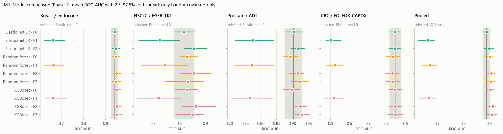

### ΔAUC from the genome

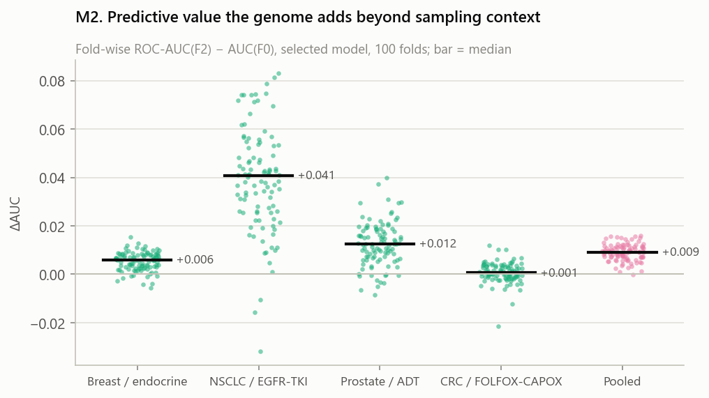

### ROC and PR curves

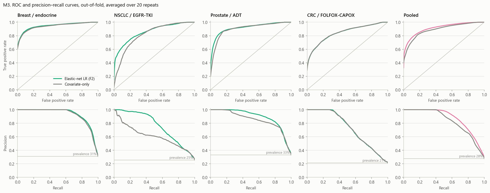

### Calibration

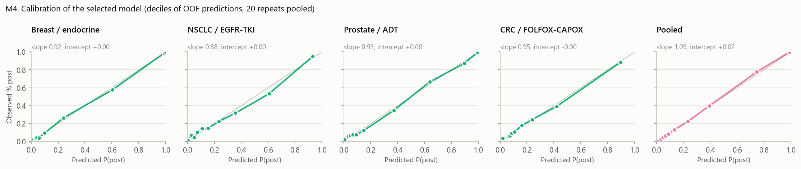

### SHAP beeswarm

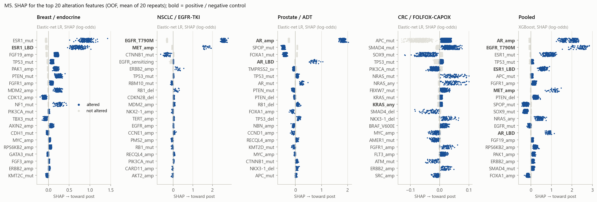

### Importance and stability

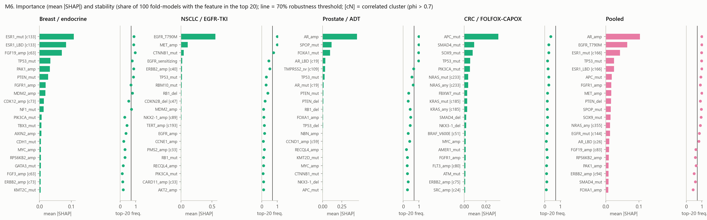

### Block share

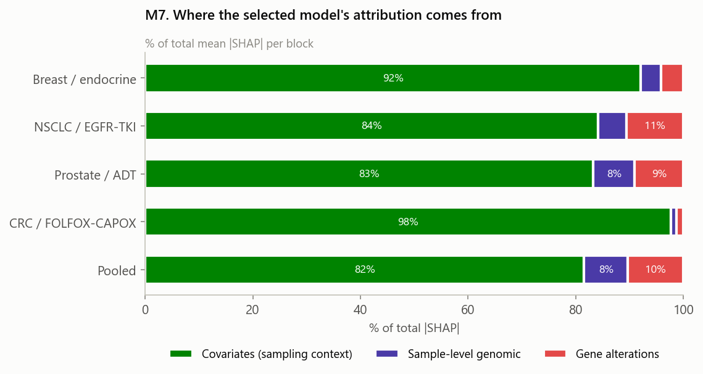

### Site interaction

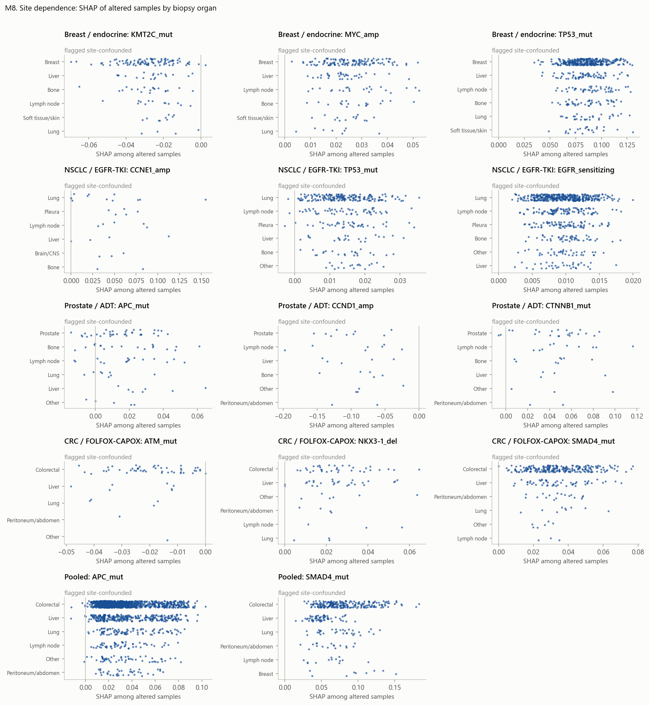

### Strict-tier confirmation

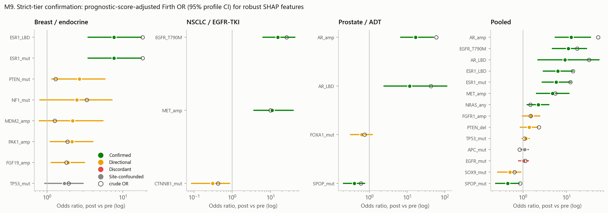

### Learning curve

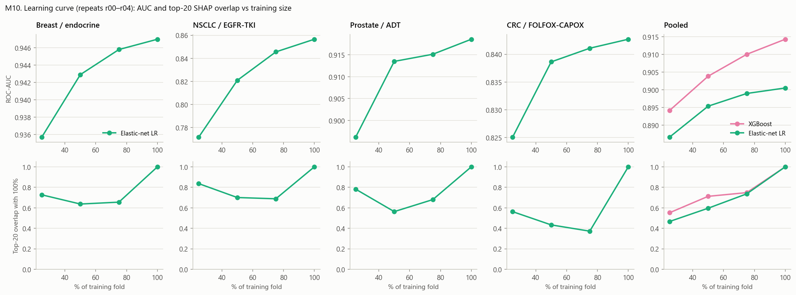

### Stratified AUC

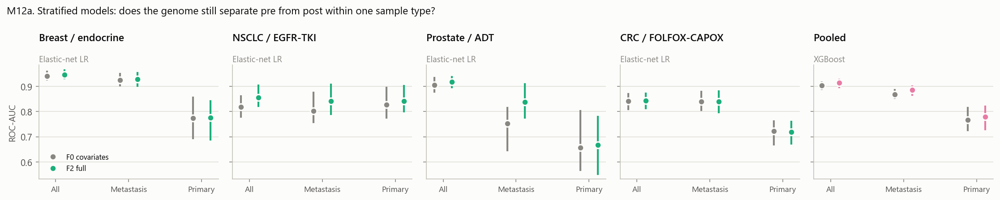

### Stratified enrichment

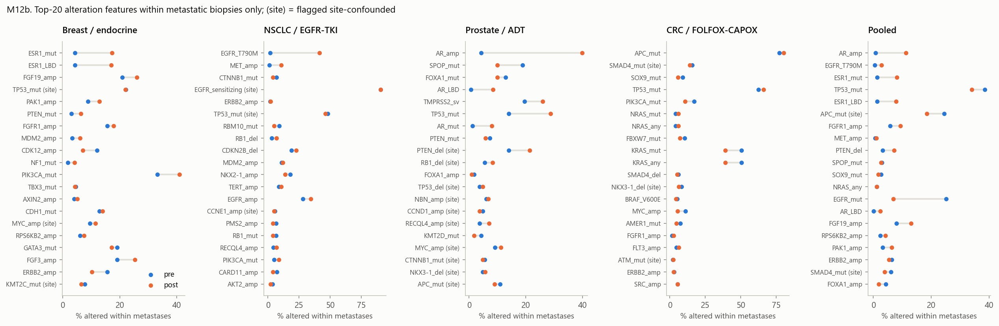

## Tables

### MT1. All models × feature sets (Phase 1, repeats r00–r04)

| cohort | model | fs | roc_auc | auc_fold_lo | auc_fold_hi | ap | brier | logloss | cal_intercept | cal_slope |
|---|---|---|---:|---:|---:|---:|---:|---:|---:|---:|
| breast | covonly | F0 | 0.941 | 0.925 | 0.957 | 0.921 | 0.0724 | 0.246 | -0.00363 | 1.07 |
| breast | lr | F0 | 0.942 | 0.926 | 0.959 | 0.921 | 0.072 | 0.242 | -0.00362 | 0.998 |
| breast | lr | F1 | 0.663 | 0.623 | 0.714 | 0.533 | 0.19 | 0.566 | 0.00337 | 0.994 |
| breast | lr | F2 | 0.947 | 0.932 | 0.965 | 0.928 | 0.0689 | 0.233 | -0.00741 | 0.918 |
| breast | prevalence | F0 | 0.496 | 0.5 | 0.5 | 0.307 | 0.214 | 0.618 | 1.81e-05 | -4 |
| breast | rf | F0 | 0.947 | 0.931 | 0.964 | 0.923 | 0.0737 | 0.249 | -0.00539 | 1.17 |
| breast | rf | F1 | 0.665 | 0.624 | 0.713 | 0.516 | 0.191 | 0.567 | 0.00652 | 1 |
| breast | rf | F2 | 0.949 | 0.935 | 0.969 | 0.927 | 0.0711 | 0.245 | -0.00786 | 1.19 |
| breast | rf | F3 | 0.946 | 0.93 | 0.968 | 0.925 | 0.0757 | 0.259 | -0.0181 | 1.18 |
| breast | xgb | F0 | 0.949 | 0.934 | 0.967 | 0.927 | 0.0703 | 0.237 | 0.00554 | 1.08 |
| breast | xgb | F1 | 0.664 | 0.632 | 0.723 | 0.529 | 0.19 | 0.566 | 0.00944 | 1.03 |
| breast | xgb | F2 | 0.952 | 0.939 | 0.968 | 0.932 | 0.0671 | 0.23 | 0.00877 | 1.1 |
| breast | xgb | F3 | 0.951 | 0.935 | 0.975 | 0.934 | 0.0695 | 0.237 | 0.0203 | 1.14 |
| nsclc | covonly | F0 | 0.819 | 0.782 | 0.858 | 0.611 | 0.142 | 0.434 | 0.0109 | 0.999 |
| nsclc | lr | F0 | 0.818 | 0.779 | 0.861 | 0.623 | 0.141 | 0.432 | 0.00848 | 0.99 |
| nsclc | lr | F1 | 0.726 | 0.646 | 0.803 | 0.616 | 0.135 | 0.445 | -0.00214 | 0.961 |
| nsclc | lr | F2 | 0.857 | 0.822 | 0.904 | 0.756 | 0.115 | 0.372 | 0.0113 | 0.878 |
| nsclc | prevalence | F0 | 0.494 | 0.5 | 0.5 | 0.252 | 0.19 | 0.567 | 2.02e-05 | -4.02 |
| nsclc | rf | F0 | 0.831 | 0.804 | 0.87 | 0.622 | 0.139 | 0.427 | -0.00858 | 1.3 |
| nsclc | rf | F1 | 0.746 | 0.655 | 0.834 | 0.636 | 0.134 | 0.44 | -0.00193 | 1.04 |
| nsclc | rf | F2 | 0.857 | 0.805 | 0.92 | 0.751 | 0.117 | 0.378 | -0.0118 | 1.33 |
| nsclc | rf | F3 | 0.833 | 0.748 | 0.894 | 0.732 | 0.125 | 0.406 | -0.0272 | 1.41 |
| nsclc | xgb | F0 | 0.831 | 0.787 | 0.87 | 0.634 | 0.138 | 0.424 | 0.023 | 1.2 |
| nsclc | xgb | F1 | 0.721 | 0.642 | 0.81 | 0.621 | 0.134 | 0.441 | 0.00892 | 1.06 |
| nsclc | xgb | F2 | 0.865 | 0.812 | 0.94 | 0.763 | 0.111 | 0.363 | 0.04 | 1.25 |
| nsclc | xgb | F3 | 0.852 | 0.791 | 0.895 | 0.748 | 0.118 | 0.383 | 0.045 | 1.36 |
| prostate | covonly | F0 | 0.903 | 0.875 | 0.932 | 0.847 | 0.107 | 0.349 | 0.000363 | 1.01 |
| prostate | lr | F0 | 0.905 | 0.879 | 0.935 | 0.851 | 0.106 | 0.344 | 0.00132 | 0.988 |
| prostate | lr | F1 | 0.774 | 0.718 | 0.84 | 0.724 | 0.151 | 0.473 | 0.00375 | 1 |
| prostate | lr | F2 | 0.919 | 0.897 | 0.939 | 0.888 | 0.0943 | 0.314 | 0.000518 | 0.935 |
| prostate | prevalence | F0 | 0.496 | 0.5 | 0.5 | 0.328 | 0.221 | 0.634 | 1.32e-05 | -4.02 |
| prostate | rf | F0 | 0.894 | 0.871 | 0.917 | 0.827 | 0.114 | 0.369 | -0.00375 | 1.02 |
| prostate | rf | F1 | 0.772 | 0.717 | 0.842 | 0.71 | 0.152 | 0.477 | 0.00367 | 1.05 |
| prostate | rf | F2 | 0.918 | 0.892 | 0.936 | 0.866 | 0.101 | 0.334 | 0.00374 | 1.07 |
| prostate | rf | F3 | 0.922 | 0.896 | 0.95 | 0.876 | 0.102 | 0.335 | 0.0209 | 1.12 |
| prostate | xgb | F0 | 0.9 | 0.871 | 0.923 | 0.841 | 0.109 | 0.354 | 0.0123 | 1.05 |
| prostate | xgb | F1 | 0.765 | 0.706 | 0.839 | 0.712 | 0.153 | 0.478 | 0.013 | 1.04 |
| prostate | xgb | F2 | 0.925 | 0.91 | 0.945 | 0.885 | 0.0961 | 0.315 | 0.021 | 1.03 |
| prostate | xgb | F3 | 0.93 | 0.91 | 0.953 | 0.892 | 0.0962 | 0.313 | 0.0468 | 1.05 |
| crc | covonly | F0 | 0.844 | 0.814 | 0.873 | 0.721 | 0.103 | 0.34 | 0.000613 | 1.05 |
| crc | lr | F0 | 0.842 | 0.81 | 0.869 | 0.722 | 0.102 | 0.338 | 0.000403 | 1 |
| crc | lr | F1 | 0.503 | 0.476 | 0.556 | 0.219 | 0.167 | 0.517 | -5.38e-05 | 0.171 |
| crc | lr | F2 | 0.843 | 0.812 | 0.872 | 0.72 | 0.103 | 0.34 | -0.000223 | 0.956 |
| crc | prevalence | F0 | 0.495 | 0.5 | 0.5 | 0.21 | 0.167 | 0.516 | -2.4e-05 | -4.02 |
| crc | rf | F0 | 0.834 | 0.796 | 0.868 | 0.703 | 0.107 | 0.357 | -0.0156 | 1.06 |
| crc | rf | F1 | 0.525 | 0.481 | 0.563 | 0.236 | 0.167 | 0.516 | -0.00235 | 0.539 |
| crc | rf | F2 | 0.829 | 0.791 | 0.861 | 0.693 | 0.109 | 0.363 | -0.0314 | 1.07 |
| crc | rf | F3 | 0.829 | 0.797 | 0.866 | 0.689 | 0.109 | 0.363 | -0.0456 | 1.11 |
| crc | xgb | F0 | 0.842 | 0.81 | 0.876 | 0.719 | 0.103 | 0.343 | 0.00785 | 1.09 |
| crc | xgb | F1 | 0.519 | 0.47 | 0.568 | 0.229 | 0.167 | 0.517 | -0.00117 | 0.499 |
| crc | xgb | F2 | 0.844 | 0.812 | 0.878 | 0.714 | 0.104 | 0.346 | 0.0105 | 1.11 |
| crc | xgb | F3 | 0.846 | 0.807 | 0.884 | 0.717 | 0.103 | 0.344 | 0.0275 | 1.13 |
| pooled | covonly | F0 | 0.89 | 0.875 | 0.905 | 0.827 | 0.102 | 0.33 | 0.00132 | 1.03 |
| pooled | lr | F0 | 0.89 | 0.875 | 0.904 | 0.828 | 0.102 | 0.329 | 0.00144 | 0.996 |
| pooled | lr | F1 | 0.665 | 0.629 | 0.689 | 0.537 | 0.17 | 0.521 | 0.000405 | 0.973 |
| pooled | lr | F2 | 0.901 | 0.882 | 0.917 | 0.85 | 0.0944 | 0.309 | 0.00138 | 0.962 |
| pooled | prevalence | F0 | 0.498 | 0.5 | 0.5 | 0.276 | 0.2 | 0.59 | -3.36e-06 | -3.99 |
| pooled | rf | F0 | 0.903 | 0.887 | 0.914 | 0.843 | 0.0979 | 0.322 | -0.0121 | 1.08 |
| pooled | rf | F1 | 0.674 | 0.643 | 0.698 | 0.539 | 0.17 | 0.522 | 0.00471 | 1.01 |
| pooled | rf | F2 | 0.909 | 0.89 | 0.922 | 0.859 | 0.0926 | 0.309 | -0.016 | 1.15 |
| pooled | rf | F3 | 0.907 | 0.888 | 0.92 | 0.859 | 0.0958 | 0.318 | -0.0295 | 1.18 |
| pooled | xgb | F0 | 0.905 | 0.89 | 0.917 | 0.845 | 0.0969 | 0.315 | 0.00732 | 1.07 |
| pooled | xgb | F1 | 0.669 | 0.633 | 0.694 | 0.542 | 0.17 | 0.52 | 0.00239 | 1.08 |
| pooled | xgb | F2 | 0.914 | 0.897 | 0.926 | 0.865 | 0.0894 | 0.296 | 0.0175 | 1.09 |
| pooled | xgb | F3 | 0.911 | 0.893 | 0.927 | 0.864 | 0.0918 | 0.304 | 0.0223 | 1.12 |

### MT3. SHAP ranking, selected model (top 30 alteration features + all robust)

| cohort | feature | rank_alt | mean_abs_shap | mean_shap_altered | top20_freq | robust | cluster | site_confounded | organ_interaction_share |
|---|---|---:|---:|---:|---:|---:|---:|---|---:|
| breast | ESR1_mut | 1 | 0.108 | 0.907 | 0.89 | True | 133 | False | 0.00692 |
| breast | ESR1_LBD | 2 | 0.084 | 0.709 | 0.87 | True | 133 | False | 0.00675 |
| breast | FGF19_amp | 3 | 0.0704 | 0.19 | 0.96 | True | 63 | False | 0.0143 |
| breast | TP53_mut | 4 | 0.0345 | 0.0856 | 0.77 | True |  | True | 0.00895 |
| breast | PAK1_amp | 5 | 0.0325 | 0.175 | 0.87 | True |  | False | 0.0182 |
| breast | PTEN_mut | 6 | 0.0271 | 0.245 | 0.85 | True |  | False | 0.00575 |
| breast | FGFR1_amp | 7 | 0.0197 | 0.0704 | 0.69 | False |  | False | 0.135 |
| breast | MDM2_amp | 8 | 0.0184 | 0.227 | 0.79 | True |  | False | 0.0151 |
| breast | CDK12_amp | 9 | 0.014 | -0.0944 | 0.54 | False | 73 | False | 0.00485 |
| breast | NF1_mut | 10 | 0.0129 | 0.256 | 0.72 | True |  | False | 0.0257 |
| breast | PIK3CA_mut | 11 | 0.00672 | 0.00861 | 0.29 | False |  | False | 0.00291 |
| breast | TBX3_mut | 12 | 0.0063 | -0.0747 | 0.44 | False |  | False | 0.00247 |
| breast | AXIN2_amp | 13 | 0.00605 | 0.0694 | 0.37 | False |  | False | 0.00171 |
| breast | CDH1_mut | 14 | 0.00469 | -0.0167 | 0.23 | False |  | False | 0 |
| breast | MYC_amp | 15 | 0.00454 | 0.0258 | 0.31 | False |  | True | 0 |
| breast | RPS6KB2_amp | 16 | 0.00447 | 0.0442 | 0.31 | False |  | False | 0.0125 |
| breast | GATA3_mut | 17 | 0.00408 | -0.0116 | 0.2 | False |  | False | 0.0131 |
| breast | FGF3_amp | 18 | 0.00361 | 0.0102 | 0.13 | False | 63 | False | 0.00476 |
| breast | ERBB2_amp | 19 | 0.00334 | 0.0154 | 0.16 | False | 73 | False | 0 |
| breast | KMT2C_mut | 20 | 0.00331 | -0.027 | 0.2 | False |  | True | 0.0107 |
| breast | MAP2K4_mut | 21 | 0.00206 | -0.0323 | 0.17 | False |  | False |  |
| breast | FGF4_amp | 22 | 0.00203 | 0.0054 | 0.09 | False | 63 | False | 0.0813 |
| breast | AURKA_amp | 23 | 0.00143 | -0.0168 | 0.1 | False |  | False | 0 |
| breast | RAD51C_amp | 24 | 0.00136 | 0.0128 | 0.1 | False | 345 | False | 0 |
| breast | MDM4_amp | 25 | 0.00122 | 0.0259 | 0.07 | False | 201 | True | 0.091 |
| breast | PRKAR1A_amp | 26 | 0.00119 | 0.015 | 0.06 | False |  | False | 0 |
| breast | MAP3K1_mut | 27 | 0.00119 | -0.00789 | 0.07 | False |  | True | 0 |
| breast | AKT1_mut | 28 | 0.00114 | -0.0119 | 0.07 | False |  | False | 0.735 |
| breast | CCND1_amp | 29 | 0.00105 | 0.00141 | 0.07 | False | 63 | False | 0 |
| breast | RECQL4_amp | 30 | 0.001 | 0.00897 | 0.06 | False |  | False | 0 |
| crc | APC_mut | 1 | 0.0316 | 0.0204 | 0.38 | False |  | False | 0.000552 |
| crc | SMAD4_mut | 2 | 0.00926 | 0.0347 | 0.26 | False |  | True | 0 |
| crc | SOX9_mut | 3 | 0.0079 | -0.0449 | 0.26 | False |  | False | 0.00285 |
| crc | TP53_mut | 4 | 0.0056 | 0.00437 | 0.18 | False |  | False | 0.0271 |
| crc | PIK3CA_mut | 5 | 0.00538 | -0.0179 | 0.21 | False |  | False | 0 |
| crc | NRAS_mut | 6 | 0.00377 | 0.0453 | 0.25 | False | 233 | False | 0 |
| crc | NRAS_any | 6 | 0.00377 | 0.0453 | 0.25 | False | 233 | False | 0 |
| crc | FBXW7_mut | 8 | 0.00289 | 0.0139 | 0.18 | False |  | False | 0 |
| crc | KRAS_mut | 9 | 0.00277 | 0.00331 | 0.16 | False | 185 | False | 0.0126 |
| crc | KRAS_any | 9 | 0.00277 | 0.00331 | 0.16 | False | 185 | False | 0 |
| crc | SMAD4_del | 11 | 0.00194 | -0.0293 | 0.18 | False |  | False | 0.00302 |
| crc | NKX3-1_del | 12 | 0.00181 | 0.0256 | 0.15 | False |  | True | 0 |
| crc | BRAF_V600E | 13 | 0.00149 | 0.0148 | 0.14 | False | 51 | False | 0 |
| crc | MYC_amp | 14 | 0.00145 | -0.0137 | 0.09 | False |  | False | 0 |
| crc | AMER1_mut | 15 | 0.00137 | -0.0156 | 0.13 | False |  | False | 0 |
| crc | FGFR1_amp | 16 | 0.00135 | 0.0253 | 0.15 | False |  | False | 0.00451 |
| crc | FLT3_amp | 17 | 0.00118 | 0.0102 | 0.11 | False | 80 | False |  |
| crc | ATM_mut | 18 | 0.00116 | -0.0205 | 0.11 | False |  | True | 0 |
| crc | ERBB2_amp | 19 | 0.00103 | 0.0199 | 0.12 | False | 75 | False | 0 |
| crc | SRC_amp | 20 | 0.000953 | -0.0101 | 0.1 | False | 24 | False | 0 |
| crc | ARID1A_mut | 21 | 0.000925 | 0.0134 | 0.08 | False |  | True | 0 |
| crc | RECQL4_amp | 22 | 0.000906 | 0.0135 | 0.1 | False |  | True | 0.00747 |
| crc | ASXL1_amp | 23 | 0.000855 | -0.00866 | 0.08 | False | 24 | False |  |
| crc | BCL2L1_amp | 24 | 0.000777 | 0.00619 | 0.06 | False | 24 | True | 0 |
| crc | CDK8_amp | 25 | 0.000758 | -0.00951 | 0.05 | False | 80 | True | 0.018 |
| crc | CDK12_amp | 26 | 0.000602 | 0.0145 | 0.03 | False | 75 | False | 0 |
| crc | PIK3R1_mut | 27 | 0.000533 | -0.00897 | 0.02 | False |  | False | 0 |
| crc | FLT1_amp | 28 | 0.00053 | 0.00521 | 0.06 | False | 80 | False | 0 |
| crc | IRS2_amp | 29 | 0.000364 | -0.00736 | 0.01 | False | 122 | True | 0 |
| crc | BRAF_mut | 30 | 0.000338 | 0.000405 | 0.05 | False | 51 | False | 0 |
| nsclc | EGFR_T790M | 1 | 0.554 | 2.56 | 1 | True |  | False | 0.00115 |
| nsclc | MET_amp | 2 | 0.109 | 1.68 | 1 | True |  | False | 0.00196 |
| nsclc | CTNNB1_mut | 3 | 0.0453 | -0.331 | 0.76 | True |  | False | 0.0109 |
| nsclc | EGFR_sensitizing | 4 | 0.0178 | 0.00968 | 0.45 | False |  | True | 0.0202 |
| nsclc | ERBB2_amp | 5 | 0.0141 | 0.248 | 0.52 | False | 40 | False | 0.00836 |
| nsclc | TP53_mut | 6 | 0.0132 | 0.0147 | 0.3 | False |  | True | 0.0213 |
| nsclc | RBM10_mut | 7 | 0.0107 | -0.0592 | 0.28 | False |  | False | 0.0147 |
| nsclc | RB1_del | 8 | 0.00851 | 0.153 | 0.39 | False |  | False | 0.00613 |
| nsclc | CDKN2B_del | 9 | 0.00816 | 0.0268 | 0.21 | False | 47 | False | 0 |
| nsclc | MDM2_amp | 10 | 0.00607 | 0.0301 | 0.12 | False |  | False |  |
| nsclc | NKX2-1_amp | 11 | 0.006 | -0.0196 | 0.13 | False | 89 | False | 0.016 |
| nsclc | TERT_amp | 12 | 0.00441 | 0.0257 | 0.17 | False | 193 | False | 0.00778 |
| nsclc | EGFR_amp | 13 | 0.00431 | 0.00853 | 0.18 | False |  | False | 0.0252 |
| nsclc | CCNE1_amp | 14 | 0.00389 | 0.0466 | 0.11 | False |  | True |  |
| nsclc | PMS2_amp | 15 | 0.00344 | -0.0462 | 0.17 | False | 33 | False |  |
| nsclc | RB1_mut | 16 | 0.00326 | -0.0273 | 0.12 | False |  | False | 0 |
| nsclc | RECQL4_amp | 17 | 0.00297 | 0.0361 | 0.12 | False |  | False |  |
| nsclc | PIK3CA_mut | 18 | 0.0025 | 0.0193 | 0.09 | False |  | False | 0 |
| nsclc | CARD11_amp | 19 | 0.0022 | -0.031 | 0.12 | False | 33 | False |  |
| nsclc | AKT2_amp | 20 | 0.00191 | -0.0288 | 0.12 | False |  | False | 0.0249 |
| nsclc | CDKN2A_del | 21 | 0.00182 | 0.00549 | 0.08 | False | 47 | False |  |
| nsclc | SDHA_amp | 22 | 0.0015 | -0.00941 | 0.05 | False | 193 | True | 0.0284 |
| nsclc | IKZF1_amp | 23 | 0.00135 | 0.0187 | 0.06 | False |  | False | 0.174 |
| nsclc | CDK4_amp | 24 | 0.00131 | -0.0071 | 0.04 | False |  | True |  |
| nsclc | SMAD4_mut | 25 | 0.00116 | 0.00783 | 0.05 | False |  | False | 0.48 |
| nsclc | MYC_amp | 26 | 0.000943 | -0.00221 | 0.06 | False |  | False |  |
| nsclc | NKX3-1_del | 27 | 0.000771 | 0.0181 | 0.03 | False |  | False |  |
| nsclc | CDKN2A_mut | 28 | 0.000565 | -0.00525 | 0.02 | False |  | False |  |
| nsclc | MED12_mut | 29 | 0.000547 | 0.0119 | 0.02 | False |  | False |  |
| nsclc | CCND1_amp | 30 | 0.000545 | -0.012 | 0.02 | False | 35 | False |  |
| pooled | AR_amp | 1 | 0.103 | 1.89 | 1 | True |  | False | 0.0159 |
| pooled | EGFR_T790M | 2 | 0.0648 | 2.41 | 1 | True |  | False | 0.00255 |
| pooled | ESR1_mut | 3 | 0.0429 | 0.853 | 0.98 | True | 166 | False | 0.00643 |
| pooled | TP53_mut | 4 | 0.0254 | 0.0326 | 0.98 | True |  | False | 0.223 |
| pooled | ESR1_LBD | 5 | 0.0253 | 0.584 | 1 | True | 166 | False | 0.00439 |
| pooled | APC_mut | 6 | 0.0185 | 0.0323 | 0.93 | True |  | True | 0.0188 |
| pooled | FGFR1_amp | 7 | 0.0168 | 0.139 | 0.9 | True |  | False | 0.0554 |
| pooled | MET_amp | 8 | 0.0166 | 1.11 | 1 | True |  | False | 0.0055 |
| pooled | PTEN_del | 9 | 0.0161 | 0.22 | 0.9 | True |  | False | 0.0328 |
| pooled | SPOP_mut | 10 | 0.0155 | -0.296 | 0.96 | True |  | False | 0.0107 |
| pooled | SOX9_mut | 11 | 0.0149 | -0.258 | 0.95 | True |  | False | 0.0187 |
| pooled | NRAS_any | 12 | 0.0134 | 0.428 | 0.89 | True | 355 | False | 0.00834 |
| pooled | EGFR_mut | 13 | 0.0133 | -0.0573 | 0.84 | True | 144 | False | 0.0539 |
| pooled | AR_LBD | 14 | 0.011 | 0.86 | 0.8 | True | 26 | False | 0.00607 |
| pooled | FGF19_amp | 15 | 0.00986 | 0.0651 | 0.61 | False | 83 | False | 0.0279 |
| pooled | RPS6KB2_amp | 16 | 0.00901 | 0.209 | 0.57 | False |  | False | 0.0191 |
| pooled | PAK1_amp | 17 | 0.00888 | 0.128 | 0.62 | False |  | False | 0.00712 |
| pooled | ERBB2_amp | 18 | 0.00863 | 0.087 | 0.49 | False | 94 | False | 0.00682 |
| pooled | SMAD4_mut | 19 | 0.00849 | 0.0744 | 0.58 | False |  | True | 0.0125 |
| pooled | FOXA1_amp | 20 | 0.00759 | -0.152 | 0.44 | False |  | False | 0.00806 |
| pooled | PIK3CA_mut | 21 | 0.00678 | -0.00484 | 0.64 | False |  | False | 0.0675 |
| pooled | GATA3_mut | 22 | 0.00657 | -0.06 | 0.37 | False |  | True | 0.0266 |
| pooled | EGFR_sensitizing | 23 | 0.00627 | 0.0205 | 0.57 | False | 144 | False | 0.0354 |
| pooled | KRAS_mut | 24 | 0.00507 | 0.0113 | 0.48 | False | 290 | False | 0.0951 |
| pooled | BRIP1_amp | 25 | 0.00462 | 0.116 | 0.16 | False |  | False | 0.0149 |
| pooled | MYC_amp | 26 | 0.00432 | -0.03 | 0.25 | False |  | True | 0.0573 |
| pooled | FGF3_amp | 27 | 0.0036 | 0.0243 | 0.11 | False | 83 | False | 0.0244 |
| pooled | KMT2C_mut | 28 | 0.00306 | 0.0488 | 0.1 | False |  | False | 0.0191 |
| pooled | FBXW7_mut | 29 | 0.00269 | 0.0321 | 0.1 | False |  | True | 0.00799 |
| pooled | RECQL4_amp | 30 | 0.00246 | 0.0265 | 0.05 | False |  | True | 0.00383 |
| prostate | AR_amp | 1 | 0.444 | 1.81 | 1 | True |  | False | 0.123 |
| prostate | SPOP_mut | 2 | 0.117 | -0.462 | 1 | True |  | False | 0.039 |
| prostate | FOXA1_mut | 3 | 0.0962 | -0.398 | 0.99 | True |  | False | 0.0696 |
| prostate | AR_LBD | 4 | 0.037 | 0.721 | 0.99 | True | 19 | False | 0.0054 |
| prostate | TMPRSS2_sv | 5 | 0.0325 | -0.0637 | 0.67 | False | 109 | False | 0.124 |
| prostate | TP53_mut | 6 | 0.025 | 0.0672 | 0.55 | False |  | False | 0.135 |
| prostate | AR_mut | 7 | 0.0122 | 0.236 | 0.63 | False | 19 | False | 0.0251 |
| prostate | PTEN_mut | 8 | 0.00849 | -0.0752 | 0.34 | False |  | False | 0.134 |
| prostate | PTEN_del | 9 | 0.00802 | -0.0324 | 0.32 | False |  | True | 0.0402 |
| prostate | RB1_del | 10 | 0.00671 | 0.0924 | 0.44 | False |  | True | 0.195 |
| prostate | FOXA1_amp | 11 | 0.00603 | -0.119 | 0.48 | False |  | False | 0.035 |
| prostate | TP53_del | 12 | 0.006 | 0.127 | 0.45 | False |  | True | 0.0381 |
| prostate | NBN_amp | 13 | 0.0047 | -0.0715 | 0.31 | False |  | True | 0.0728 |
| prostate | CCND1_amp | 14 | 0.00449 | -0.0932 | 0.41 | False | 59 | True | 0.0248 |
| prostate | RECQL4_amp | 15 | 0.00348 | 0.0497 | 0.2 | False |  | True | 0.0372 |
| prostate | KMT2D_mut | 16 | 0.00339 | -0.0664 | 0.27 | False |  | False | 0.0882 |
| prostate | MYC_amp | 17 | 0.00315 | -0.0233 | 0.25 | False |  | True | 0.0245 |
| prostate | CTNNB1_mut | 18 | 0.00313 | 0.0464 | 0.26 | False |  | True | 0.278 |
| prostate | NKX3-1_del | 19 | 0.00309 | 0.06 | 0.31 | False |  | True | 0.16 |
| prostate | APC_mut | 20 | 0.00238 | 0.0168 | 0.27 | False |  | True | 0.193 |
| prostate | CDK12_mut | 21 | 0.00186 | 0.013 | 0.2 | False |  | False | 0.0726 |
| prostate | AR_sv | 22 | 0.00179 | 0.152 | 0.4 | False |  | True | 0 |
| prostate | BRCA2_mut | 23 | 0.0017 | 0.0307 | 0.2 | False |  | True |  |
| prostate | ERG_sv | 24 | 0.0017 | 0.000313 | 0.12 | False | 109 | False | 0.087 |
| prostate | PIK3CA_mut | 25 | 0.00144 | 0.0203 | 0.15 | False |  | True | 0.147 |
| prostate | KMT2C_mut | 26 | 0.000641 | -0.00743 | 0.09 | False |  | False | 0.416 |
| prostate | MAP3K1_del | 27 | 0.000624 | -0.0131 | 0.03 | False | 182 | True | 0.142 |
| prostate | TBX3_amp | 28 | 0.000479 | 0.00466 | 0.04 | False |  | True |  |
| prostate | KDM6A_mut | 29 | 0.000336 | -0.00473 | 0.02 | False |  | True |  |
| prostate | RB1_mut | 30 | 3.42e-05 | 0 | 0.01 | False |  | False |  |

### MT4. Strict-tier Firth (robust features, controls, and q < 0.10)

| cohort | feature | n_altered_pre | n_altered_post | or_crude | or_adj | ci_low_adj | ci_high_adj | ci_type_adj | q_adj | or_full | full_moved | robust | agreement |
|---|---|---:|---:|---:|---:|---:|---:|---|---:|---:|---|---|---|
| breast | ESR1_mut | 13 | 54 | 18.2 | 7.63 | 3.5 | 17.5 | profile | 4.7e-06 | 10.8 | False | True | Confirmed |
| breast | ESR1_LBD | 13 | 54 | 18.2 | 7.63 | 3.5 | 17.5 | profile | 4.7e-06 | 10.8 | False | True | Confirmed |
| breast | FGF19_amp | 130 | 59 | 1.8 | 1.9 | 1.14 | 3.11 | profile | 0.178 | 1.84 | False | True | Directional |
| breast | PAK1_amp | 65 | 32 | 1.86 | 2.15 | 1.12 | 4.01 | profile | 0.178 | 2.03 | False | True | Directional |
| breast | PTEN_mut | 39 | 14 | 1.3 | 2.67 | 1.16 | 5.79 | profile | 0.178 | 2.9 | False | True | Directional |
| breast | TP53_mut | 82 | 41 | 1.93 | 1.69 | 0.934 | 2.98 | profile | 0.333 | 1.72 | False | True | Site-confounded |
| breast | MDM2_amp | 26 | 9 | 1.26 | 2.19 | 0.799 | 5.46 | profile | 0.371 | 2.2 | False | True | Directional |
| breast | NF1_mut | 12 | 11 | 3.34 | 2.48 | 0.809 | 7.19 | profile | 0.371 | 3.06 | False | True | Directional |
| crc | NRAS_any | 58 | 26 | 1.85 | 2.42 | 1.33 | 4.26 | profile | 0.0844 | 2.48 | False | False | Confirmed |
| crc | NRAS_mut | 58 | 26 | 1.85 | 2.42 | 1.33 | 4.26 | profile | 0.0844 | 2.48 | False | False | Confirmed |
| crc | KRAS_any | 618 | 148 | 0.917 | 0.814 | 0.602 | 1.1 | profile | 0.585 | 0.805 | False | False | Discordant |
| nsclc | EGFR_T790M | 6 | 38 | 26.3 | 15.5 | 6.44 | 42.8 | profile | 9.57e-10 | 17.8 | False | True | Confirmed |
| nsclc | MET_amp | 4 | 13 | 9.93 | 11 | 3.69 | 39 | profile | 0.000185 | 10.6 | False | True | Confirmed |
| nsclc | CTNNB1_mut | 29 | 4 | 0.426 | 0.31 | 0.0876 | 0.864 | profile | 0.266 | 0.267 | False | True | Directional |
| pooled | AR_amp | 6 | 95 | 53.4 | 12.9 | 5.57 | 35.6 | profile | 1.15e-10 | 11.7 | False | True | Confirmed |
| pooled | EGFR_T790M | 7 | 38 | 17.6 | 11 | 4.79 | 28.7 | profile | 1.39e-08 | 22.1 | True | True | Confirmed |
| pooled | ESR1_LBD | 13 | 54 | 14 | 6.31 | 2.94 | 14.2 | profile | 2.27e-05 | 10.4 | True | True | Confirmed |
| pooled | ESR1_mut | 15 | 54 | 12.2 | 5.83 | 2.78 | 12.7 | profile | 2.83e-05 | 7.95 | False | True | Confirmed |
| pooled | MET_amp | 10 | 17 | 5.58 | 4.79 | 2.07 | 11.5 | profile | 0.00318 | 1.97 | True | True | Confirmed |
| pooled | AR_LBD | 2 | 24 | 33.1 | 9.19 | 2.21 | 55.6 | profile | 0.0144 | 9.01 | False | True | Confirmed |
| pooled | SPOP_mut | 107 | 28 | 0.87 | 0.449 | 0.238 | 0.811 | profile | 0.0536 | 0.391 | False | True | Confirmed |
| pooled | NRAS_any | 59 | 26 | 1.48 | 2.26 | 1.26 | 3.93 | profile | 0.0536 | 2.32 | False | True | Confirmed |
| pooled | SOX9_mut | 139 | 27 | 0.64 | 0.504 | 0.266 | 0.897 | profile | 0.122 | 0.454 | False | True | Directional |
| pooled | FGFR1_amp | 130 | 58 | 1.51 | 1.56 | 0.973 | 2.43 | profile | 0.272 | 1.52 | False | True | Directional |
| pooled | TP53_mut | 1,281 | 406 | 1.08 | 1.16 | 0.957 | 1.4 | profile | 0.399 | 1.28 | False | True | Directional |
| pooled | PTEN_del | 105 | 71 | 2.33 | 1.39 | 0.883 | 2.18 | profile | 0.407 |  |  | True | Directional |
| pooled | KRAS_any | 622 | 154 | 0.785 | 0.845 | 0.654 | 1.08 | profile | 0.407 |  |  | False | Discordant |
| pooled | APC_mut | 1,191 | 323 | 0.845 | 1.1 | 0.901 | 1.34 | profile | 0.541 |  |  | True | Site-confounded |
| pooled | EGFR_mut | 329 | 111 | 1.13 | 1.04 | 0.799 | 1.34 | profile | 0.825 |  |  | True | Discordant |
| prostate | AR_amp | 5 | 93 | 59.6 | 16.7 | 6.87 | 49.8 | profile | 6.1e-12 | 14.2 | False | True | Confirmed |
| prostate | AR_LBD | 1 | 24 | 42.8 | 11.6 | 2.44 | 113 | profile | 0.012 | 10.4 | False | True | Confirmed |
| prostate | AR_mut | 1 | 22 | 39 | 11.4 | 2.39 | 112 | profile | 0.012 | 10.6 | False | False | Confirmed |
| prostate | SPOP_mut | 107 | 28 | 0.599 | 0.402 | 0.208 | 0.745 | profile | 0.0242 | 0.36 | False | True | Confirmed |
| prostate | FOXA1_mut | 92 | 29 | 0.741 | 0.628 | 0.318 | 1.19 | profile | 0.621 | 0.59 | False | True | Directional |

### MT5. Target B regression

Not run yet: `python train_models.py targetB finalize`, then rerun this script.

### MT6. Sensitivity analyses (selected model, repeats r00–r04)

| cohort | variant | model | fs | n | pct_post | roc_auc | lo | hi | auc_main_same_model |
|---|---|---|---|---:|---:|---:|---:|---:|---:|
| breast | a_on | lr | F2 | 2.25e+03 | 0.21 | 0.953 | 0.935 | 0.972 | 0.947 |
| breast | hyper_incl | xgb | F2 | 2.61e+03 | 0.314 | 0.952 | 0.94 | 0.97 | 0.952 |
| breast | met_only | lr | F0 | 1.02e+03 | 0.681 | 0.925 | 0.904 | 0.95 | 0.942 |
| breast | met_only | lr | F2 | 1.02e+03 | 0.681 | 0.929 | 0.903 | 0.955 | 0.947 |
| breast | prim_only | lr | F0 | 1.54e+03 | 0.0615 | 0.773 | 0.694 | 0.857 | 0.942 |
| breast | prim_only | lr | F2 | 1.54e+03 | 0.0615 | 0.775 | 0.689 | 0.842 | 0.947 |
| breast | s3 | lr | F2 | 2.09e+03 | 0.38 | 0.957 | 0.945 | 0.974 | 0.947 |
| breast | strict_trained | lr | F2 | 1.03e+03 | 0.222 | 0.904 | 0.859 | 0.943 | 0.947 |
| crc | a_on | lr | F2 | 1.82e+03 | 0.0204 | 0.798 | 0.609 | 0.913 | 0.843 |
| crc | hyper_incl | xgb | F2 | 2.42e+03 | 0.206 | 0.84 | 0.812 | 0.871 | 0.844 |
| crc | met_only | lr | F0 | 590 | 0.502 | 0.839 | 0.806 | 0.879 | 0.842 |
| crc | met_only | lr | F2 | 590 | 0.502 | 0.839 | 0.797 | 0.881 | 0.843 |
| crc | prim_only | lr | F0 | 1.66e+03 | 0.107 | 0.722 | 0.669 | 0.762 | 0.842 |
| crc | prim_only | lr | F2 | 1.66e+03 | 0.107 | 0.719 | 0.672 | 0.759 | 0.843 |
| crc | s3 | lr | F2 | 1.92e+03 | 0.248 | 0.848 | 0.82 | 0.875 | 0.843 |
| crc | strict_trained | lr | F2 | 1.85e+03 | 0.201 | 0.846 | 0.815 | 0.874 | 0.843 |
| nsclc | a_on | lr | F2 | 700 | 0.201 | 0.857 | 0.786 | 0.924 | 0.857 |
| nsclc | hyper_incl | xgb | F2 | 753 | 0.255 | 0.867 | 0.824 | 0.928 | 0.865 |
| nsclc | met_only | lr | F0 | 363 | 0.281 | 0.803 | 0.758 | 0.876 | 0.818 |
| nsclc | met_only | lr | F2 | 363 | 0.281 | 0.842 | 0.79 | 0.908 | 0.857 |
| nsclc | prim_only | lr | F0 | 380 | 0.221 | 0.828 | 0.776 | 0.895 | 0.818 |
| nsclc | prim_only | lr | F2 | 380 | 0.221 | 0.842 | 0.801 | 0.903 | 0.857 |
| nsclc | s3 | lr | F2 | 602 | 0.317 | 0.862 | 0.822 | 0.909 | 0.857 |
| nsclc | strict_trained | lr | F2 | 432 | 0.252 | 0.773 | 0.655 | 0.867 | 0.857 |
| pooled | a_on | xgb | F2 | 6.13e+03 | 0.167 | 0.946 | 0.933 | 0.959 | 0.914 |
| pooled | hyper_incl | xgb | F2 | 7.29e+03 | 0.275 | 0.914 | 0.896 | 0.925 | 0.914 |
| pooled | met_only | lr | F2 | 2.55e+03 | 0.59 | 0.874 | 0.858 | 0.894 | 0.901 |
| pooled | met_only | xgb | F0 | 2.55e+03 | 0.59 | 0.869 | 0.855 | 0.885 | 0.905 |
| pooled | met_only | xgb | F2 | 2.55e+03 | 0.59 | 0.886 | 0.866 | 0.901 | 0.914 |
| pooled | prim_only | lr | F2 | 4.49e+03 | 0.0963 | 0.746 | 0.694 | 0.793 | 0.901 |
| pooled | prim_only | xgb | F0 | 4.49e+03 | 0.0963 | 0.766 | 0.727 | 0.815 | 0.905 |
| pooled | prim_only | xgb | F2 | 4.49e+03 | 0.0963 | 0.779 | 0.73 | 0.821 | 0.914 |
| pooled | s3 | xgb | F2 | 5.82e+03 | 0.336 | 0.921 | 0.903 | 0.932 | 0.914 |
| pooled | strict_trained | xgb | F2 | 4.31e+03 | 0.233 | 0.882 | 0.862 | 0.908 | 0.914 |
| prostate | a_on | lr | F2 | 1.37e+03 | 0.275 | 0.924 | 0.895 | 0.953 | 0.919 |
| prostate | hyper_incl | xgb | F2 | 1.52e+03 | 0.331 | 0.927 | 0.912 | 0.945 | 0.925 |
| prostate | met_only | lr | F0 | 576 | 0.715 | 0.753 | 0.647 | 0.815 | 0.905 |
| prostate | met_only | lr | F2 | 576 | 0.715 | 0.838 | 0.776 | 0.909 | 0.919 |
| prostate | prim_only | lr | F0 | 901 | 0.0832 | 0.657 | 0.568 | 0.802 | 0.905 |
| prostate | prim_only | lr | F2 | 901 | 0.0832 | 0.667 | 0.552 | 0.78 | 0.919 |
| prostate | s3 | lr | F2 | 1.2e+03 | 0.407 | 0.928 | 0.911 | 0.946 | 0.919 |
| prostate | strict_trained | lr | F2 | 996 | 0.293 | 0.929 | 0.901 | 0.949 | 0.919 |

### MT7. Stratified enrichment (top-20 features, relaxed training rows)

| cohort | feature | rank_alt | pct_pre_all | pct_post_all | pct_pre_met | pct_post_met | pct_pre_prim | pct_post_prim | log_or_all | log_or_mh | site_confounded |
|---|---|---:|---:|---:|---:|---:|---:|---:|---:|---:|---:|
| breast | ESR1_mut | 1 | 1.29 | 16.5 | 4.31 | 17.3 | 0.621 | 9.47 | 2.69 | 1.64 | False |
| breast | ESR1_LBD | 2 | 1.24 | 16.2 | 4.31 | 17 | 0.552 | 9.47 | 2.72 | 1.63 | False |
| breast | FGF19_amp | 3 | 15.4 | 25.5 | 20.9 | 26 | 14.2 | 22.1 | 0.632 | 0.35 | False |
| breast | TP53_mut | 4 | 19 | 22.3 | 22.2 | 21.9 | 18.3 | 25.3 | 0.199 | 0.0965 | True |
| breast | PAK1_amp | 5 | 7.6 | 13.2 | 8.92 | 12.8 | 7.31 | 14.7 | 0.616 | 0.518 | False |
| breast | PTEN_mut | 6 | 5.06 | 6.42 | 3.08 | 6.35 | 5.52 | 6.32 | 0.255 | 0.535 | False |
| breast | FGFR1_amp | 7 | 12.3 | 17.7 | 15.7 | 17.9 | 11.5 | 15.8 | 0.434 | 0.219 | False |
| breast | MDM2_amp | 8 | 3.26 | 5.79 | 3.38 | 6.06 | 3.24 | 4.21 | 0.601 | 0.5 | False |
| breast | CDK12_amp | 9 | 7.71 | 6.79 | 12 | 7.07 | 6.76 | 4.21 | -0.131 | -0.536 | False |
| breast | NF1_mut | 10 | 1.52 | 4.53 | 1.85 | 4.18 | 1.45 | 7.37 | 1.12 | 1.03 | False |
| breast | PIK3CA_mut | 11 | 38.3 | 40.8 | 33.2 | 40.8 | 39.4 | 37.9 | 0.104 | 0.225 | False |
| breast | TBX3_mut | 12 | 4.39 | 3.77 | 4.62 | 4.33 | 4.34 | 0 | -0.148 | -0.376 | False |
| breast | AXIN2_amp | 13 | 3.94 | 5.53 | 4 | 5.19 | 3.93 | 8.42 | 0.361 | 0.433 | False |
| breast | CDH1_mut | 14 | 13.8 | 13.6 | 12.9 | 14 | 14 | 10.5 | -0.015 | -0.0135 | False |
| breast | MYC_amp | 15 | 7.65 | 11.3 | 9.54 | 11.5 | 7.24 | 8.42 | 0.433 | 0.215 | True |
| breast | RPS6KB2_amp | 16 | 3.6 | 7.8 | 6.15 | 7.5 | 3.03 | 9.47 | 0.817 | 0.455 | False |
| breast | GATA3_mut | 17 | 18 | 17 | 19.1 | 17.2 | 17.7 | 16.8 | -0.0656 | -0.11 | False |
| breast | FGF3_amp | 18 | 14.4 | 24.5 | 19.1 | 25.3 | 13.4 | 18.9 | 0.658 | 0.378 | False |
| breast | ERBB2_amp | 19 | 11 | 10.2 | 15.7 | 10.2 | 10 | 8.42 | -0.0855 | -0.391 | False |
| breast | KMT2C_mut | 20 | 5.97 | 6.79 | 7.69 | 6.49 | 5.59 | 9.47 | 0.143 | 0.038 | True |
| crc | APC_mut | 1 | 77.1 | 78.9 | 77.2 | 80.1 | 77.1 | 77.5 | 0.0999 | 0.0868 | False |
| crc | SMAD4_mut | 2 | 12.7 | 15.1 | 15.6 | 14.2 | 12.1 | 16.9 | 0.206 | 0.144 | True |
| crc | SOX9_mut | 3 | 9.34 | 6.9 | 9.18 | 5.74 | 9.38 | 7.87 | -0.317 | -0.278 | False |
| crc | TP53_mut | 4 | 63.2 | 63.2 | 62.2 | 65.9 | 63.3 | 59 | -4.54e-05 | -0.0304 | False |
| crc | PIK3CA_mut | 5 | 16 | 12.1 | 17 | 10.8 | 15.8 | 14 | -0.318 | -0.312 | False |
| crc | NRAS_mut | 6 | 3.54 | 6.49 | 4.08 | 6.08 | 3.44 | 7.3 | 0.643 | 0.602 | False |
| crc | NRAS_any | 6 | 3.54 | 6.49 | 4.08 | 6.08 | 3.44 | 7.3 | 0.643 | 0.602 | False |
| crc | FBXW7_mut | 8 | 10.5 | 10.3 | 10.5 | 7.09 | 10.5 | 15.7 | -0.016 | 0.113 | False |
| crc | KRAS_mut | 9 | 42 | 41 | 50.3 | 39.2 | 40.3 | 44.9 | -0.0387 | -0.127 | False |
| crc | KRAS_any | 9 | 42 | 41 | 50.3 | 39.2 | 40.3 | 44.9 | -0.0387 | -0.127 | False |
| crc | SMAD4_del | 11 | 3.26 | 3.35 | 6.12 | 5.07 | 2.7 | 0.562 | 0.0481 | -0.432 | False |
| crc | NKX3-1_del | 12 | 2.92 | 5.23 | 8.16 | 6.42 | 1.89 | 2.25 | 0.615 | -0.071 | True |
| crc | BRAF_V600E | 13 | 4.84 | 5.02 | 5.1 | 4.39 | 4.79 | 6.18 | 0.0533 | 0.0889 | False |
| crc | MYC_amp | 14 | 5.34 | 4.81 | 10.9 | 5.41 | 4.25 | 3.93 | -0.0949 | -0.471 | False |
| crc | AMER1_mut | 15 | 4.39 | 4.39 | 7.48 | 4.73 | 3.78 | 3.93 | 0.0179 | -0.239 | False |
| crc | FGFR1_amp | 16 | 2.25 | 3.56 | 1.7 | 2.7 | 2.36 | 5.06 | 0.487 | 0.648 | False |
| crc | FLT3_amp | 17 | 5.96 | 5.86 | 4.76 | 6.42 | 6.21 | 5.06 | -0.00652 | 0.0492 | False |
| crc | ATM_mut | 18 | 2.87 | 2.09 | 2.04 | 2.36 | 3.04 | 1.12 | -0.285 | -0.269 | True |
| crc | ERBB2_amp | 19 | 2.81 | 2.93 | 3.06 | 2.7 | 2.77 | 3.37 | 0.0662 | 0.0707 | False |
| crc | SRC_amp | 20 | 4.78 | 4.39 | 5.44 | 5.41 | 4.66 | 1.69 | -0.0717 | -0.285 | False |
| nsclc | EGFR_T790M | 1 | 1.79 | 37.2 | 1.92 | 41.2 | 1.69 | 34.5 | 3.44 | 3.26 | False |
| nsclc | MET_amp | 2 | 0.894 | 9.95 | 1.15 | 10.8 | 0.676 | 9.52 | 2.43 | 2.18 | False |
| nsclc | CTNNB1_mut | 3 | 7.33 | 4.71 | 6.9 | 3.92 | 7.77 | 5.95 | -0.43 | -0.364 | False |
| nsclc | EGFR_sensitizing | 4 | 90.2 | 93.2 | 90.4 | 90.2 | 89.9 | 97.6 | 0.375 | 0.394 | True |
| nsclc | ERBB2_amp | 5 | 1.97 | 4.19 | 1.92 | 1.96 | 2.03 | 7.14 | 0.793 | 0.773 | False |
| nsclc | TP53_mut | 6 | 43.5 | 49.2 | 47.9 | 46.1 | 39.2 | 53.6 | 0.231 | 0.205 | True |
| nsclc | RBM10_mut | 7 | 10 | 5.76 | 9.2 | 4.9 | 10.8 | 5.95 | -0.566 | -0.552 | False |
| nsclc | RB1_del | 8 | 1.97 | 5.24 | 3.07 | 6.86 | 1.01 | 3.57 | 1.01 | 0.897 | False |
| nsclc | CDKN2B_del | 9 | 14.3 | 19.4 | 18.8 | 22.5 | 10.5 | 16.7 | 0.369 | 0.346 | False |
| nsclc | MDM2_amp | 10 | 10.6 | 10.5 | 11.1 | 11.8 | 10.1 | 8.33 | 0.00547 | -0.0103 | False |
| nsclc | NKX2-1_amp | 11 | 15 | 12 | 18 | 13.7 | 12.5 | 10.7 | -0.242 | -0.241 | False |
| nsclc | TERT_amp | 12 | 8.23 | 9.95 | 8.81 | 10.8 | 7.77 | 9.52 | 0.222 | 0.231 | False |
| nsclc | EGFR_amp | 13 | 20.8 | 29.8 | 28 | 34.3 | 14.5 | 22.6 | 0.487 | 0.42 | False |
| nsclc | CCNE1_amp | 14 | 4.11 | 5.24 | 5.75 | 4.9 | 2.7 | 5.95 | 0.278 | 0.253 | True |
| nsclc | PMS2_amp | 15 | 3.58 | 2.62 | 6.51 | 3.92 | 1.01 | 0 | -0.253 | -0.41 | False |
| nsclc | RB1_mut | 16 | 6.26 | 4.19 | 6.51 | 3.92 | 6.08 | 4.76 | -0.379 | -0.327 | False |
| nsclc | RECQL4_amp | 17 | 3.4 | 5.24 | 4.21 | 6.86 | 2.7 | 3.57 | 0.472 | 0.436 | False |
| nsclc | PIK3CA_mut | 18 | 6.08 | 7.33 | 4.98 | 8.82 | 7.09 | 5.95 | 0.219 | 0.25 | False |
| nsclc | CARD11_amp | 19 | 3.58 | 2.62 | 7.28 | 3.92 | 0.338 | 0 | -0.253 | -0.432 | False |
| nsclc | AKT2_amp | 20 | 3.22 | 1.57 | 3.83 | 1.96 | 2.7 | 1.19 | -0.61 | -0.524 | False |
| pooled | AR_amp | 1 | 0.215 | 9.17 | 0.766 | 11.3 | 0.074 | 1.85 | 3.8 | 2.72 | False |
| pooled | EGFR_T790M | 2 | 0.215 | 3.64 | 0.479 | 2.79 | 0.148 | 6.71 | 2.82 | 2.38 | False |
| pooled | ESR1_mut | 3 | 0.49 | 6.76 | 1.34 | 8.05 | 0.271 | 2.08 | 2.67 | 1.84 | False |
| pooled | TP53_mut | 4 | 36.3 | 36.1 | 38.6 | 34.1 | 35.6 | 43.5 | -0.00675 | 0.000942 | False |
| pooled | ESR1_LBD | 5 | 0.431 | 6.61 | 1.34 | 7.85 | 0.197 | 2.08 | 2.77 | 1.85 | False |
| pooled | APC_mut | 6 | 28.2 | 21.7 | 24.5 | 18.4 | 29.2 | 33.3 | -0.347 | -0.111 | True |
| pooled | FGFR1_amp | 7 | 5.33 | 8.55 | 5.84 | 9.38 | 5.2 | 5.56 | 0.509 | 0.375 | False |
| pooled | MET_amp | 8 | 0.274 | 1.28 | 0.575 | 0.998 | 0.197 | 2.31 | 1.54 | 1.17 | False |
| pooled | PTEN_del | 9 | 2.66 | 6.3 | 3.16 | 7.19 | 2.54 | 3.47 | 0.899 | 0.697 | False |
| pooled | SPOP_mut | 10 | 2.78 | 2.36 | 2.97 | 2.73 | 2.74 | 0.926 | -0.164 | -0.33 | False |
| pooled | SOX9_mut | 11 | 3.35 | 2.1 | 2.68 | 1.66 | 3.53 | 3.24 | -0.471 | -0.251 | False |
| pooled | NRAS_any | 12 | 1.25 | 1.64 | 1.15 | 1.2 | 1.28 | 3.24 | 0.279 | 0.496 | False |
| pooled | EGFR_mut | 13 | 11.1 | 9.93 | 25.2 | 6.92 | 7.42 | 19.7 | -0.121 | -0.481 | False |
| pooled | AR_LBD | 14 | 0.0588 | 1.89 | 0.0958 | 2.4 | 0.0493 | 0.231 | 3.35 | 2.43 | False |
| pooled | FGF19_amp | 15 | 6.03 | 11.4 | 7.95 | 13 | 5.55 | 5.56 | 0.692 | 0.408 | False |
| pooled | RPS6KB2_amp | 16 | 1.45 | 3.89 | 2.39 | 4.19 | 1.21 | 2.78 | 1.01 | 0.646 | False |
| pooled | PAK1_amp | 17 | 2.86 | 5.68 | 3.26 | 6.32 | 2.76 | 3.24 | 0.717 | 0.541 | False |
| pooled | ERBB2_amp | 18 | 5.05 | 5.27 | 6.32 | 5.39 | 4.74 | 4.63 | 0.0477 | -0.105 | False |
| pooled | SMAD4_mut | 19 | 5.31 | 4.76 | 6.03 | 3.93 | 5.13 | 7.87 | -0.111 | -0.0414 | True |
| pooled | FOXA1_amp | 20 | 2.57 | 1.95 | 4.31 | 1.8 | 2.12 | 2.55 | -0.274 | -0.501 | False |
| prostate | AR_amp | 1 | 0.807 | 35.4 | 4.27 | 39.8 | 0.121 | 10.7 | 4.15 | 2.72 | False |
| prostate | SPOP_mut | 2 | 14.2 | 9.41 | 18.9 | 9.95 | 13.3 | 5.33 | -0.462 | -0.762 | False |
| prostate | FOXA1_mut | 3 | 12.8 | 10.4 | 12.8 | 9.95 | 12.8 | 13.3 | -0.228 | -0.146 | False |
| prostate | AR_LBD | 4 | 0.202 | 7.36 | 0.61 | 8.5 | 0.121 | 1.33 | 3.46 | 2.15 | False |
| prostate | TMPRSS2_sv | 5 | 25.6 | 25.4 | 19.5 | 26 | 26.8 | 21.3 | -0.013 | 0.107 | False |
| prostate | TP53_mut | 6 | 14.8 | 27 | 14 | 28.6 | 14.9 | 18.7 | 0.752 | 0.647 | False |
| prostate | AR_mut | 7 | 0.303 | 6.95 | 1.22 | 8.01 | 0.121 | 1.33 | 3.06 | 1.69 | False |
| prostate | PTEN_mut | 8 | 5.75 | 5.93 | 7.32 | 5.83 | 5.45 | 6.67 | 0.0403 | -0.0704 | False |
| prostate | PTEN_del | 9 | 8.78 | 19.4 | 14 | 21.4 | 7.75 | 9.33 | 0.917 | 0.429 | True |
| prostate | RB1_del | 10 | 1.82 | 8.18 | 5.49 | 8.25 | 1.09 | 8 | 1.56 | 0.755 | True |
| prostate | FOXA1_amp | 11 | 3.13 | 1.02 | 1.83 | 0.971 | 3.39 | 1.33 | -1.06 | -0.619 | False |
| prostate | TP53_del | 12 | 1.21 | 4.7 | 3.66 | 4.85 | 0.726 | 2.67 | 1.37 | 0.494 | True |
| prostate | NBN_amp | 13 | 2.22 | 6.13 | 6.1 | 6.8 | 1.33 | 2.67 | 1.05 | 0.135 | True |
| prostate | CCND1_amp | 14 | 1.61 | 3.27 | 4.88 | 3.64 | 0.969 | 1.33 | 0.723 | -0.175 | True |
| prostate | RECQL4_amp | 15 | 2.32 | 6.13 | 3.66 | 7.04 | 1.94 | 1.33 | 1.01 | 0.39 | True |
| prostate | KMT2D_mut | 16 | 2.12 | 1.64 | 4.27 | 1.7 | 1.69 | 1.33 | -0.227 | -0.638 | False |
| prostate | MYC_amp | 17 | 4.84 | 10 | 9.15 | 11.2 | 3.87 | 4 | 0.782 | 0.139 | True |
| prostate | CTNNB1_mut | 18 | 2.62 | 4.91 | 5.49 | 4.85 | 2.06 | 5.33 | 0.651 | 0.182 | True |
| prostate | NKX3-1_del | 19 | 1.41 | 5.11 | 4.88 | 5.58 | 0.726 | 2.67 | 1.31 | 0.3 | True |
| prostate | APC_mut | 20 | 5.05 | 8.38 | 11 | 8.98 | 3.87 | 4 | 0.545 | -0.126 | True |
