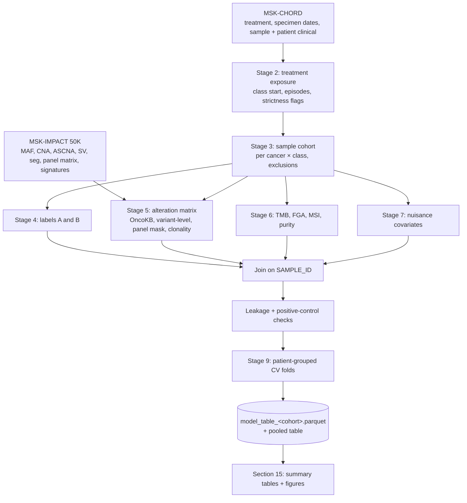

# Data Cleaning and Preprocessing Plan (v3)

**Project:** Pseudo-longitudinal resistance signatures: which genomic alterations are enriched
in tumors sampled after, and longer into, first-line therapy
**Data:** MSK-CHORD 2024 (treatment, dates, sample metadata) + MSK-IMPACT 50K 2026 (genomics),
cBioPortal exports in `data/raw/`
**Builds on:** `data/loaders.py`, `data/build_features.py`, `data/fig_event_*.py`, `data/data_exploration.ipynb`
**Replaces:** v2 of this plan (same design; v3 adds control-contamination rules, survivorship
and adjuvant handling, prognostic-score adjustment, and implementation instructions). v1
(metastasis time-to-event design) is in the git history.

All counts in this plan come from checks run against the raw files. Values marked *expected*
are what the pipeline should reproduce (within a small tolerance); the summary outputs in
[Section 15](#15-summary-tables-and-visualizations-generated-at-the-end) report the actual values.

---

## 0. Instructions for implementation (read first)

### 0.1 Milestones

Build and verify in this order. Do not start a milestone until the previous one's checks pass.

| Milestone | Build | Done when |
|---|---|---|
| **M1** | Stage 0 caching, Stages 2–4 (`exposure.py`, `build_cohort.py`), tables T1 and T4 (raw-mutation version), checklist items 1–7 | The Section 2.1 cohort counts and the Section 2.2 control prevalences reproduce within ±2% |
| **M2** | Stages 5–8 (`build_alterations.py`, `preprocess.py`), rule-based oncogenicity fallback, panel masking, checklist items 8–14 | Controls still hold after the OncoKB/fallback filter and panel mask (T4 recomputed) |
| **M3** | Stage 9 models, per-gene Firth, stability selection, `report.py` with tables T2–T10 and figures F1–F12 | All checklist asserts pass; `reports/README.md` builds |

Within a milestone, stop and report if any Section 2.2 control fails rather than continuing.

### 0.2 Decisions

The decisions in Section 17 are **resolved**: use the "Decision" column as given. Do not ask
about them unless the data makes a choice impossible, in which case say why and propose a
fallback.

### 0.3 Environment and conventions

- Python ≥ 3.11, `pandas ≥ 2.2`, `pyarrow`, `scikit-learn ≥ 1.5`, `lightgbm`, `shap`,
  `firthlogist` (Firth logistic regression; see Section 13.5), `statsmodels`, `pyyaml`.
- **Cache raw files once.** On first load, write `data_mutations.txt`, `data_CNA.ascna.txt`
  and `data_cna_hg19.seg` to `data/raw/cache/*.parquet` with the `usecols` from Section 4.
  Every later read goes through the cache. Never re-parse the text files in a loop.
- MSK-MET is **not on disk** and not required. Skip the FGA cross-check (Section 10) unless
  `data/raw/msk_met/` exists; log that it was skipped.
- OncoKB: build the rule-based fallback (Section 9.1) first. The OncoKB annotator path sits
  behind `config.oncogenicity_source: oncokb | rules` and is used only if
  `data/raw/oncokb/` already contains annotated files. Do not call the OncoKB API.
- All dates are integer day offsets on the MSK-CHORD axis (Section 4). There is no calendar
  date column anywhere; do not search for one.
- Every stage writes its parquet output and a one-paragraph log (row counts in and out) to
  `data/derived/logs/<stage>.md`.
- Run checklist items (Section 16) as `assert`s inside the stage that produces the
  relevant output, not in a separate script run at the end.

---

## Contents

0. [Instructions for implementation](#0-instructions-for-implementation-read-first)
1. [Study design](#1-study-design)
2. [What the data supports](#2-what-the-data-supports)
3. [Pipeline overview](#3-pipeline-overview)
4. [Stage 0: Loading conventions](#4-stage-0-loading-conventions)
5. [Stage 1: Carried-over fixes and retired steps](#5-stage-1-carried-over-fixes-and-retired-steps)
6. [Stage 2: Treatment exposure](#6-stage-2-treatment-exposure)
7. [Stage 3: Sample cohort and exclusions](#7-stage-3-sample-cohort-and-exclusions)
8. [Stage 4: Labels](#8-stage-4-labels)
9. [Stage 5: Alteration matrix](#9-stage-5-alteration-matrix)
10. [Stage 6: Sample-level genomic features](#10-stage-6-sample-level-genomic-features)
11. [Stage 7: Nuisance covariates](#11-stage-7-nuisance-covariates)
12. [Stage 8: Missing data](#12-stage-8-missing-data)
13. [Stage 9: Splitting, validation and attribution](#13-stage-9-splitting-validation-and-attribution)
14. [Output files](#14-output-files)
15. [Summary tables and visualizations generated at the end](#15-summary-tables-and-visualizations-generated-at-the-end)
16. [Validation checklist](#16-validation-checklist)
17. [Resolved decisions and sensitivity analyses](#17-resolved-decisions-and-sensitivity-analyses)

---

## 1. Study design

| Element | Definition |
|---|---|
| **Unit** | One sequenced tumor sample with a known collection date (MSK-CHORD `data_timeline_specimen_surgery.txt`) and MSK-IMPACT genomics |
| **Cohorts** | One cancer type × one drug class: **Breast / endocrine**, **NSCLC / EGFR-TKI**, **Prostate / ADT**, **CRC / FOLFOX-CAPOX**. Pooled analysis only with class as a covariate |
| **Time zero** | First dose of the cohort's drug class (Section 6) |
| **Target A** (classification) | `sampled_after_tx` = 1 if collected > 90 days after class start, 0 if collected on or before class start; samples in (0, 90] days excluded |
| **Target B** (regression) | Cumulative days on the class at collection; 0 for pre-treatment samples |
| **Features** | Gene-level alteration matrix (oncogenic mutations, amplifications, deep deletions, fusions), variant-level features for drug-target genes, clonality per alteration, TMB, FGA, MSI, purity |
| **Nuisance covariates** | Sample type, biopsy organ, metastatic status at collection, sex, sequencing era (panel version, patient-ID number), purity, adjuvant start, plus the clinical covariates in Section 11. Adjusted for, not interpreted |
| **Models** | (1) Per-gene Firth logistic regression adjusted for a cohort-level prognostic score (Section 13.4) → odds ratios with CIs. (2) Penalized logistic regression and gradient boosting on the full matrix → coefficients / SHAP |
| **Scientific output** | Per-gene attributions and odds ratios, not AUC |

**Why "pseudo-longitudinal".** Each patient contributes one dated sample (11,515 samples for
11,515 patients across the four cohorts). Repeat samples exist in MSK-IMPACT but have no
collection dates, so they cannot be placed relative to treatment. Before vs after therapy is
therefore compared **across patients**, never within one patient.

---

## 2. What the data supports

### 2.1 Samples per cohort

`t` = collection date minus first dose of the cohort's class. **Strict** = class was the
patient's first systemic therapy (within 30 days), no medication before MSK recorded, FACETS
QC pass (definitions in Section 6.4).

| Cohort | Samples | t ≤ 0 | 0 < t ≤ 90 d | **t > 90 d** | t > 90 d, on class at collection | Strict t ≤ 0 | **Strict t > 90 d** | Strict t > 90 d, no other therapy between | Median t (t > 90 d) |
|---|---:|---:|---:|---:|---:|---:|---:|---:|---:|
| Breast / endocrine | 3,992 | 2,638 | 285 | 1,069 | 615 | 827 | 236 | 116 | 1,189 d |
| NSCLC / EGFR-TKI | 1,314 | 974 | 72 | 268 | 202 | 339 | 115 | 80 | 562 d |
| Prostate / ADT | 2,696 | 1,852 | 242 | 602 | 451 | 717 | 297 | 111 | 1,012 d |
| CRC / FOLFOX-CAPOX | 3,513 | 2,815 | 86 | 612 | 57 | 1,580 | 391 | 187 | 360 d |
| **Total** | 11,515 | 8,279 | 685 | **2,551** | 1,325 | 3,463 | **1,039** | **494** | |

### 2.2 Positive and negative controls already visible

Loose cohort definition, all mutations (no oncogenicity filter, no panel masking):

| Cohort | Alteration | Pre (t ≤ 0) | Post (t > 90 d) | Expected direction |
|---|---|---:|---:|---|
| Breast | ESR1 mutation | 2.5% | **14.3%** | ↑ known endocrine resistance |
| NSCLC | EGFR T790M | 1.5% | **26.9%** | ↑ known 1st-gen TKI resistance |
| NSCLC | EGFR C797S | 0.3% | 1.5% | ↑ osimertinib resistance (rare) |
| NSCLC | MET amplification | 0.8% | **7.1%** | ↑ known TKI bypass |
| Prostate | AR amplification | 1.3% | **29.1%** | ↑ known ADT resistance |
| Prostate | AR mutation | 0.8% | **8.5%** | ↑ known ADT / AR inhibitor resistance |
| CRC | KRAS mutation | 35.7% | 37.9% | ≈ negative control (truncal driver) |

The design recovers the known biology. The cleaning pipeline must preserve this: the
validation checklist (Section 16) requires these controls to hold after every change.

### 2.3 Consequences for cleaning

1. **Strictness versus sample size is the main trade-off.** Strict criteria shrink post-treatment
   samples from 2,551 to 1,039 (494 without intervening therapy). Run the strict definition as the
   main analysis and the relaxed one as a sensitivity analysis.
2. **Time since start is not exposure.** Only 57 of 612 post-FOLFOX samples were collected on
   treatment (FOLFOX is a fixed course). Target B therefore uses cumulative days on the drug.
3. **Panel version is confounded with the label.** Post-treatment samples are *more* often
   on older panels (IMPACT341/410: 35.2% post vs 21.7% pre). Panel masking and an era covariate
   are mandatory.
4. **Adjuvant starts are not limited to breast.** Adjuvant FOLFOX for stage III colon cancer is
   a large share of the CRC cohort and explains why only 57 of 612 post-FOLFOX samples were
   collected on treatment. A post-treatment sample after an adjuvant start is a recurrence
   biopsy, not a progression-on-therapy biopsy. `adjuvant_start` is therefore defined for every
   cohort (Section 6.3).
5. **Post-treatment patients are survivors.** They lived long enough (median 1–3 years) to be
   re-biopsied; the pre-treatment group includes patients who died within months. This is a
   property of the design, not a bug, but it needs the survivorship sensitivity in Section 17
   (S3) and a sentence in the limitations.

---

## 3. Pipeline overview



**Proposed file layout:**

```
data/
  loaders.py                 # Stage 0 (exists)
  exposure.py                # NEW Stage 2: class definitions, episodes, flags
  build_cohort.py            # NEW Stages 3–4: sample cohort + labels
  build_alterations.py       # NEW Stages 5–6: alteration matrix + genomic features
  preprocess.py              # NEW Stages 7–9: covariates, missing data, CV folds
  report.py                  # NEW Section 15 outputs
  config/
    drug_classes.yaml        # agent lists per class (Section 6.1)
    target_variants.yaml     # variant-level features (Section 9.3)
    site_map.csv             # free-text biopsy site → organ (Section 11)
  raw/oncokb/                # OncoKB-annotated MAF / CNA / SV (Section 9.1)
  raw/panels/                # IMPACT341/410/468/505 gene lists (Section 9.5)
  derived/
    exposure.parquet          # one row per patient × class
    samples.parquet           # one row per sample: cohort, t, labels, flags
    alterations_long.parquet  # one row per sample × alteration
    alteration_matrix.parquet # wide: sample × feature (with NA masking)
    model_table_<cohort>.parquet
  reports/
```

`build_features.py` and `derived/cohort.parquet` belong to the v1 design. Keep them for the
exploration notebook but do not build on them.

---

## 4. Stage 0: Loading conventions

| Convention | Rule |
|---|---|
| Clinical files | `skiprows=4` (row 5 is the header) |
| Large files | Always pass `usecols` (`data_mutations.txt` 190 MB, `data_CNA.ascna.txt` 103 MB, `data_cna_hg19.seg` 149 MB), then cache as parquet in `data/raw/cache/` (Section 0.3) |
| IDs | `PATIENT_ID` = `P-XXXXXXX`; `SAMPLE_ID` = `P-XXXXXXX-TNN-IMN`. The suffix encodes the panel: IM3 = IMPACT341, IM5 = 410, IM6 = 468, IM7 = 505 |
| Time axis | MSK-CHORD days, where 0 = the patient's first sequencing. Treatment, diagnosis, specimen and progression timelines all share it, so **no re-anchoring is needed** |
| Sample date | **Collection** date (`specimen_surgery.START_DATE`), not sequencing date (`SEQ_DATE`). Both are integer day offsets on the same axis; `SEQ_DATE` is not a calendar date. The median gap is 36 days, and 13.9% of samples are collected more than a year before sequencing (archived tissue) |
| Dates | Keep as integer day offsets; never convert to `datetime` |
| Mixed types | `pd.to_numeric(errors="coerce")` for count columns (`t_ref_count` contains strings) |
| MSK-MET | Not required by this design. Optional only for cross-checking FGA (Section 10) |

---

## 5. Stage 1: Carried-over fixes and retired steps

| v1 item | Status in v2 |
|---|---|
| F1 lymph-node mapping, F2 cumulative `DMETS_DX_*` flags, F3 at-risk masks, F4 sex-specific organs, F5 follow-up censoring | **Retired**: metastasis labels are no longer used |
| F6 CHORD day-0 alignment | **Simplified**: all dates come from MSK-CHORD itself; use each sample's own collection date |
| F7 untreated encoded as day 0 | **Carried over**: any "days since treatment" feature is NaN when there was no treatment, never 0 (Target B is the only exception, by definition) |
| F8 CCF from mutations failing FACETS QC | **Carried over**: use CCF only where `ASCN.FACETS_QC_PASSED == True` (36,828 mutations fail) |
| Free-text site normalization | **Carried over**: biopsy organ is now a nuisance covariate (Section 11) |
| Panel-version handling | **Upgraded**: now a gene-by-gene NA mask (Section 9.5) |

---

## 6. Stage 2: Treatment exposure

Source: `data_timeline_treatment.txt` (134,943 rows; `AGENT`, `SUBTYPE`, `START_DATE`, `STOP_DATE`).

### 6.1 Drug class definitions (`config/drug_classes.yaml`)

| Cohort | Cancer type (MSK-CHORD sample `CANCER_TYPE`) | Class agents (anchor) | Recorded separately, not part of the class |
|---|---|---|---|
| Breast / endocrine | Breast Cancer | letrozole, anastrozole, exemestane, tamoxifen, fulvestrant, toremifene, elacestrant | CDK4/6 inhibitors (palbociclib, abemaciclib, ribociclib) as a **companion-drug flag**; ovarian suppression (leuprolide, goserelin) as a flag; alpelisib, everolimus |
| NSCLC / EGFR-TKI | Non-Small Cell Lung Cancer | osimertinib, erlotinib, gefitinib, afatinib, dacomitinib | **Sub-class**: osimertinib vs first/second-generation TKI (resistance differs) |
| Prostate / ADT | Prostate Cancer | leuprolide, degarelix, goserelin, relugolix, triptorelin, histrelin, bicalutamide, nilutamide, flutamide | **AR inhibitors** (abiraterone, enzalutamide, apalutamide, darolutamide) as a separate exposure variable |
| CRC / FOLFOX-CAPOX | Colorectal Cancer | **oxaliplatin** (anchor); fluorouracil or capecitabine expected alongside | Irinotecan-based regimens, anti-EGFR antibodies, bevacizumab as later-line flags |

Agent names match MSK-CHORD's upper-case `AGENT` values. Unknown agents raise an error, so new
data cannot be silently mis-classified.

### 6.2 Exposure episodes

For each patient × class:

1. Keep only that class's rows.
2. **Drop rows before this cancer's primary diagnosis date minus 30 days** (MSK-CHORD diagnosis
   timeline, `SUBTYPE == "Primary"`). These belong to an earlier, different cancer: one NSCLC
   patient has cyclophosphamide/methotrexate/fluorouracil 15 years before the NSCLC diagnosis.
3. `class_start` = earliest remaining `START_DATE`.
4. Merge `[START_DATE, STOP_DATE]` intervals whose gaps are ≤ 60 days into episodes.
5. For each sample, `cum_days_on_class` = total episode days between `class_start` and the
   collection date (capped at the collection date).

### 6.3 Exposure variables per sample

| Variable | Definition | Role |
|---|---|---|
| `t_days` | collection date − `class_start` | Label A, exclusions |
| `cum_days_on_class` | Section 6.2 step 5; 0 if `t_days ≤ 0` | **Label B** |
| `on_class_at_collection` | collection date falls within an episode (+30 days grace) | Covariate: progression on vs after stopping the drug |
| `days_since_class_stop` | collection − end of the last episode; NaN if on class or pre-treatment | Covariate |
| `n_lines_between` | distinct other systemic classes started between `class_start + 30` and collection | Covariate / strict filter |
| `classes_between` | list of those classes | Report, sensitivity analysis |
| `prior_classes` | systemic classes started before `class_start − 30` (after primary diagnosis) | Covariate / strict filter |
| `subclass` | e.g. osimertinib vs earlier TKI; AI vs tamoxifen vs fulvestrant | Covariate; stratified analyses |
| `companion_cdk46`, `ovarian_suppression`, `ar_inhibitor_exposure` | flags per Section 6.1 | Covariates |
| `adjuvant_start` | **All cohorts:** `class_start` precedes the first distant metastasis in the MSK-CHORD metastasis timeline (or no metastasis is ever recorded). Expected to be common in breast and CRC, rare in NSCLC, mixed in prostate | Covariate; stratified analyses |
| `metastatic_at_collection` | A distant metastasis is recorded on or before the collection date | Covariate (Section 11) |
| `followup_days` | Last recorded MSK-CHORD event (any timeline) minus `class_start` | Survivorship sensitivity (Section 17, S3) |

### 6.4 Strictness tiers

| Tier | Rule | Use |
|---|---|---|
| **Strict** | Class was the first systemic therapy after this cancer's diagnosis (`class_start ≤ first systemic + 30 d`), `PRIOR_MED_TO_MSK != "Prior medications to MSK"`, FACETS QC pass | Main analysis |
| **Strict, no intervening** | Strict + `n_lines_between == 0` | Sensitivity: purest class-specific signal (494 post samples) |
| **Relaxed** | First exposure to the class; prior and intervening therapy as covariates | Sensitivity: maximum power (2,551 post samples) |

**Control contamination rule (all tiers).** `PRIOR_MED_TO_MSK == "Prior medications to MSK"`
excludes a sample from the **label-0 (pre-treatment) group in every tier**, including relaxed.
A patient treated elsewhere before their first MSK record may already carry resistance
alterations, and a contaminated control group biases every odds ratio toward the null. Only
the label-1 side relaxes between tiers. Record how many label-0 samples this removes per
cohort (Table T1).

### 6.5 Cohort-specific rules

- **Breast:** restrict to `HR == "Yes"` (drops 181 HR-negative patients who received endocrine
  therapy). HER2 status (`HER2`) is a covariate. Many endocrine starts are **adjuvant**: years of
  tamoxifen after surgery are a different exposure from first-line metastatic treatment. Report
  both together and split by `adjuvant_start`. **ESR1 control is evaluated within the
  aromatase-inhibitor subclass** (`subclass == "AI"`, with or without CDK4/6): ESR1 LBD
  mutations arise under AIs far more than under tamoxifen, so the pooled breast comparison
  understates the control. If the pooled ESR1 enrichment looks weak but the AI-stratified one
  holds, the pipeline is fine.
- **NSCLC:** check that ≥ 95% of the cohort has an EGFR-sensitizing alteration (exon 19 deletion,
  L858R, other OncoKB-oncogenic EGFR). Investigate the rest before modeling. Analyze
  osimertinib-first and earlier-TKI-first separately where the numbers allow.
- **Prostate:** the class anchor is the first GnRH agonist/antagonist or first-generation
  anti-androgen. AR-inhibitor exposure before collection is recorded separately because it drives
  AR changes on its own.
- **CRC:** `cum_days_on_class` will be short (fixed course). Expect Target B to carry little
  extra information beyond Target A here, and say so in the results. Most oxaliplatin starts
  are adjuvant; report CRC results split by `adjuvant_start` exactly as for breast.
- **NSCLC and CRC:** `sex` is a covariate (Section 11). Breast and prostate are single-sex.

---

## 7. Stage 3: Sample cohort and exclusions

Apply per cohort, in order, and record counts at each step (Table T1, Figure F1).

| Step | Rule | Expected (loose, all four cohorts) |
|---|---|---|
| 0 | MSK-CHORD samples with a collection date | 25,040 |
| 1 | Sample cancer type matches the cohort | |
| 2 | Patient received the class (Section 6.1) after primary diagnosis | 11,515 |
| 3 | Sample present in MSK-IMPACT 50K with mutation + CNA data | |
| 4 | Cohort-specific rules (Section 6.5, e.g. Breast HR+) | |
| 5 | Exclude 0 < `t_days` ≤ 90 (ambiguous window; kept for sensitivity) | −685 → 10,830 |
| 5b | Exclude label-0 samples with `PRIOR_MED_TO_MSK == "Prior medications to MSK"` (all tiers, Section 6.4) | record count |
| 6 | Strictness tier (Section 6.4) | strict: ≤ 3,463 pre / 1,039 post |
| 7 | FACETS QC pass (needed for clonality features; samples failing keep binary features only in the relaxed tier) | |

**One sample per patient.** If a patient has more than one dated sample in a cohort (rare),
keep the one with the largest `t_days` for the post-treatment group, or the latest
pre-treatment sample if all are pre-treatment. Record the choice.

**Flagged, not excluded** (sensitivity analyses in Section 17): hypermutated samples
(MSI-high or TMB > 20 mut/Mb), purity < 0.2, and archived tissue (collection > 365 days
before sequencing).

---

## 8. Stage 4: Labels

### 8.1 Target A: `sampled_after_tx`

| `t_days` | Label |
|---|---|
| ≤ 0 | 0 (collected before the first dose) |
| 0 < t ≤ 90 | excluded (resistance has not had time to emerge) |
| > 90 | 1 |

Labels are always relative to the **cohort's class**, not to the first therapy of any class.
Example: a breast patient with diagnosis → chemotherapy → sample → endocrine therapy is label
0 for the endocrine cohort.

### 8.2 Target B: `cum_days_on_class`

- 0 for all pre-treatment samples. **No negative values**: time before treatment is not
  negative exposure, and including it adds noise.
- Model `log1p(cum_days_on_class)`.
- Because ~75% of samples sit at 0, fit it as two parts: (i) Target A, (ii) dose among
  post-treatment samples only. A single regression over everyone mostly re-learns Target A.
- Always include `on_class_at_collection` and `days_since_class_stop` as covariates.

### 8.3 Label sensitivity variants

| Variant | Change | Priority |
|---|---|---|
| A-on | Post-treatment samples restricted to `on_class_at_collection == 1` | **Planned** (S2) |
| A-30 / A-180 | Post-treatment threshold 30 or 180 days instead of 90 | If time permits |
| A-progression | Post-treatment samples restricted to those within 90 days after an NLP progression call (`data_timeline_progression.txt`, probability ≥ 0.8): "sampled at progression" | If time permits |

Implement the label variants as a parameter of `build_cohort.py` (`--label-variant`), not as
separate pipelines. Only A (main) and A-on are run by default.

---

## 9. Stage 5: Alteration matrix

### 9.1 Oncogenicity annotation

None of the mutation files (MSK-IMPACT, MSK-CHORD, MSK-MET) carries OncoKB annotations;
the only annotation field is `Annotation_Status`.

- **Primary:** run the OncoKB annotators (`MafAnnotator.py`, `CnaAnnotator.py`,
  `FusionAnnotator.py` from the `oncokb-annotator` repository; free academic API token) on the
  MAF, `data_cna.txt` and `data_sv.txt`. Keep `ONCOGENIC ∈ {Oncogenic, Likely Oncogenic,
  Resistance}`. Cache the output in `data/raw/oncokb/` with the OncoKB data version, so results
  are reproducible.
- **Fallback (no token):** cancer-hotspot missense + truncating variants in tumor-suppressor
  genes + `data_cna.txt` amplifications (2) of oncogenes and deep deletions (−2) of tumor
  suppressors + fusions involving known kinase/oncogene partners. Mark which rule set was used.
- **Never use** OncoKB "level of evidence" or treatment fields as features: they encode drug
  indications, which is circular in a treatment-based design.

### 9.2 Alteration types

| Type | Source | Encoding |
|---|---|---|
| Mutation | `data_mutations.txt`, nonsynonymous + TERT promoter, OncoKB filtered | binary per gene |
| Amplification | `data_cna.txt` = 2 | binary per gene |
| Deep deletion | `data_cna.txt` = −2 | binary per gene |
| Fusion / SV | `data_sv.txt` (15,787 SVs; `Site1_Hugo_Symbol`, `Site2_Hugo_Symbol`), OncoKB filtered | binary per gene (either partner) |
| LOH | `data_CNA.ascna.txt` (`total;minor` copy number, minor = 0) | binary per tumor-suppressor gene, only where FACETS QC passes |

**Feature granularity:** keep **gene × type** features as the primary matrix (e.g.
`AR_amp`, `AR_mut`). Build the collapsed gene-level matrix (`AR_any`) as an alternative.
Collapsing merges mechanisms with different biology (AR amplification vs AR ligand-binding
mutations).

### 9.3 Variant-level features for drug-target genes (`config/target_variants.yaml`)

Gene-level features cannot detect resistance inside the drug's own target. For example, every
EGFR-TKI patient is EGFR-mutant, so `EGFR_mut` is ~100% in both groups.

| Cohort | Feature | Definition |
|---|---|---|
| NSCLC | `EGFR_T790M`, `EGFR_C797X`, `EGFR_sensitizing` (ex19del / L858R) | `HGVSp_Short` match |
| NSCLC | `MET_amp`, `ERBB2_amp` (bypass) | CNA |
| Breast | `ESR1_LBD` | ESR1 missense at E380, V422, S463, L536, Y537, D538 |
| Breast | `ESR1_fusion` | SV with ESR1 partner |
| Prostate | `AR_LBD` | AR missense at L702, W742, H875, F877, T878 (legacy numbering T877) |
| Prostate | `AR_amp`, `AR_enhancer` (if captured) | CNA / SV |
| CRC | `KRAS_any`, `NRAS_any`, `BRAF_V600E` | Negative or mixed controls (truncal drivers) |

### 9.4 Clonality encoding

CCF exists **only for mutations** (FACETS ASCN block). CNAs have allele-specific copy numbers
but no CCF; fusions have neither.

| Feature per mutated gene | Rule |
|---|---|
| `<gene>_mut_clonal` | `ASCN.CLONAL == "CLONAL"` (or CCF lower bound ≥ 0.8) |
| `<gene>_mut_subclonal` | `ASCN.CLONAL == "SUBCLONAL"` |
| `<gene>_mut_clonality_unknown` | `INDETERMINATE`, missing, or FACETS QC fail |
| `<gene>_mut_max_ccf` | Highest CCF among the gene's mutations; **only in the post-treatment-only and gradient-boosting analyses**, NA when not mutated |

This avoids a continuous CCF column that is structurally missing for most samples. In the
interpretation, a resistance alteration that is subclonal after treatment means an emerging
population; a clonal one means a completed selective sweep.

### 9.5 Gene-panel masking

The panels are nested (341 ⊂ 410 ⊂ 468 ⊂ 505 genes), and post-treatment samples sit
disproportionately on older panels. Therefore:

1. Download the four panels' gene lists from cBioPortal (`/api/gene-panels/IMPACT341`, …)
   into `data/raw/panels/`.
2. Per sample and per data type, take the panel from `data_gene_panel_matrix.txt` (columns
   `mutations`, `gistic`, `structural_variants`).
3. Set a feature to **NA** (not 0) where the gene is not on that sample's panel for that data
   type.
4. For the main analysis, keep only genes present on **all** panels, so there are no masked
   cells. Run genes from later panels as a secondary analysis restricted to the samples whose
   panel covers them.
5. Before modeling, check that every positive-control gene (ESR1, AR, EGFR, MET) is on
   IMPACT341. If one is not, restrict that gene's analysis to the panels that include it.

### 9.6 Filters

- **Prevalence:** keep a feature if it is altered in ≥ 10 samples **and** ≥ 2% of the cohort.
  For the **predictive models** (penalized LR, gradient boosting) compute this on the training
  fold only. For the **per-gene Firth analysis**, which is inferential rather than predictive,
  compute it once on the full cohort so there is a single gene list per cohort. Variant-level
  target features (Section 9.3) are always kept.
- **Hypermutated samples** (MSI-high or TMB > 20 mut/Mb): exclude from the main per-gene
  analysis; they add dozens of passenger "oncogenic" calls. Include them in a sensitivity
  analysis restricted to hotspot alterations.
- **Germline:** MSK-IMPACT is tumor–normal matched; `data_mutations.txt` is somatic. No action.

### 9.7 Mutational signatures: control, not feature

`data_mutational_signatures_contribution_v2.txt` holds the 30 **COSMIC v2** signatures for
98% of samples. Treatment-induced signatures would reveal exposure directly rather than
resistance, so signatures are **excluded from the feature matrix**. Use them as checks:

- Signature 17 (5-FU-associated in later COSMIC versions) should rise in post-FOLFOX CRC samples.
- APOBEC (Signatures 2, 13) is reported to rise after endocrine therapy in breast cancer.
- The platinum signatures (SBS31/35) are **not** in v2, so oxaliplatin exposure has no
  signature check here.
- Signature estimates from a few panel mutations are noisy. Use them only where a sample has
  ≥ 10 mutations.

---

## 10. Stage 6: Sample-level genomic features

| Feature | Source | Transform | Notes |
|---|---|---|---|
| `TMB_SCORE` | MSK-IMPACT sample | `log1p` | Already normalized per Mb, so comparable across panels |
| `FGA` | **Computed** from `data_cna_hg19.seg`: fraction of the genome in segments with \|`seg.mean`\| > 0.2 | none | Only MSK-MET has FGA. Validate the computed values against MSK-MET's FGA where samples overlap (target r > 0.95) |
| `MSI_SCORE` | MSK-IMPACT sample | none | `MSI_TYPE` "Do not report"/"Indeterminate" → NaN |
| `FACETS_PURITY`, `FACETS_PLOIDY`, `FACETS_WGD` | MSK-IMPACT sample | none | Purity is also a nuisance covariate (Section 11) |
| `n_mutations_oncogenic` | Section 9 | `log1p` | **Covariate, not an alteration feature**: it is a near-deterministic function of the alteration matrix and belongs in the Section 11 block |

`arm_altered_fraction` (from `data_armlevel_cna.txt`) is dropped: it duplicates FGA. Do not
compute it.

---

## 11. Stage 7: Nuisance covariates

These are adjusted for so the gene attributions are not confounded. They are not interpreted.

| Covariate | Source | Encoding |
|---|---|---|
| `sample_type` | MSK-CHORD `SAMPLE_TYPE` | Primary / Metastasis / Local recurrence |
| `biopsy_organ` | MSK-CHORD `METASTATIC_SITE`, else `PRIMARY_SITE`; normalized via `site_map.csv` (case/whitespace + hand map to ~15 organ groups) | categorical; groups < 30 samples → "Other". A coarse 5-level version (primary organ / liver / lung / bone / other) is also written for the prognostic score (Section 13.4) |
| `metastatic_at_collection` | Section 6.3 | binary. Distinguishes a de novo primary from a primary re-sampled after distant relapse, which `sample_type` and `stage_at_dx` do not |
| `sex` | MSK-CHORD patient `SEX` | binary; NSCLC and CRC only |
| `adjuvant_start` | Section 6.3 | binary; all cohorts |
| `n_mutations_oncogenic` | Section 10 | `log1p` |
| **Sequencing era** | **No calendar date exists in any file** (`SEQ_DATE` is a day offset). Use (a) `panel_version` from the sample-ID suffix and (b) `log(patient-ID number)`. MSK assigns patient IDs sequentially; median ID rises from ~1,500 (IMPACT341) to ~8,200 (410), ~32,600 (468) and ~63,500 (505) | categorical + continuous |
| `FACETS_PURITY` | MSK-IMPACT | continuous; also flag < 0.2 |
| `archived_tissue` | collection > 365 days before `SEQ_DATE` | binary |
| `age_at_collection` | MSK-CHORD `CURRENT_AGE_DEID` minus years from collection to last record | continuous, approximate; mark as such |
| `stage_at_dx` | MSK-CHORD diagnosis timeline (`STAGE_CDM_DERIVED` at the primary diagnosis) | Stage 1–3 / Stage 4 |
| Exposure context | Section 6.3: `prior_classes`, `n_lines_between`, `on_class_at_collection`, `subclass`, companion-drug flags | as defined |
| `HER2` (Breast) | MSK-CHORD patient | Yes / No / Unknown |
| `drug_class` (pooled model only) | cohort | categorical |

**Keeping the model from learning them:**

- **Penalized logistic regression:** covariates enter **unpenalized**; only alteration
  features are penalized. Gene effects are then conditional on the covariates.
- **Per-gene Firth regression:** adjusts for a single **prognostic score** (the covariates-only
  model's predicted logit) rather than the full covariate set; see Section 13.4. With 10–20
  altered post-treatment samples per gene, a dozen categorical covariates would produce
  separation-adjacent fits and uninformative CIs even with Firth's penalty.
- **Gradient boosting:** train with covariates, but report SHAP values for alteration features
  only, and check SHAP interaction values between alteration features and `biopsy_organ` /
  `panel_version`.
- **Diagnostic (required):** fit a covariates-only model for each target. Report its AUC (or
  R²) next to the full model's. Post-treatment samples are disproportionately metastatic
  biopsies taken at progression, so the covariates alone will predict the label to some extent.
- **Organ-specific alterations:** for any gene whose effect changes materially when
  `biopsy_organ` is added, report it as site-confounded rather than as a resistance signal.

---

## 12. Stage 8: Missing data

| Kind | Examples | Handling |
|---|---|---|
| Not measured (panel) | Gene absent from the sample's panel | NA. Main analysis uses all-panel genes (no NA); the secondary analysis restricts rows per gene |
| Structural | Clonality when not mutated; `days_since_class_stop` when on class or pre-treatment | Encoded by design (Section 9.4) or NaN + indicator; never imputed |
| Disguised | `MSI_TYPE` "Do not report"; `HER2`/`HR` blank; `stage` "Unknown" | → NaN, then an explicit "Unknown" level for categoricals |
| Missing at random (small) | Purity (FACETS QC fail), FGA | Median imputation fitted on the training fold + indicator |
| Treatment record incomplete | Medication before MSK | Excluded in the strict tier; flagged in the relaxed tier |

Never impute alteration features: absence of a call on a covering panel is a measured 0.

---

## 13. Stage 9: Splitting, validation and attribution

1. **Group by patient** (`StratifiedGroupKFold`), stratified by label and `subclass`, even
   though samples and patients are almost 1:1.
2. **Repeated cross-validation** (5 folds × 20 repeats) instead of one held-out test set. Strict
   cohorts have 80–391 post-treatment samples, too few for a stable single split.
3. Fit all transforms (imputers, scalers, prevalence filters, one-hot encoders) **inside each
   fold** on training rows only.
4. **Attribution stability:** report how often each feature is selected or ranked in the top
   20 across bootstrap resamples (stability selection). Report only features selected in
   ≥ 70% of resamples as robust.
5. **Per-gene Firth regressions** (Section 13.4 and 13.5): one model per feature; report odds
   ratios with 95% CIs and **Benjamini–Hochberg FDR** across features, per cohort.
6. **Positive controls must pass first** (Section 2.2): significant enrichment of ESR1_LBD
   (breast, evaluated within the AI subclass per Section 6.5), EGFR_T790M and MET_amp (NSCLC),
   and AR_amp / AR_LBD (prostate) in the strict tier, and no KRAS enrichment in CRC. If a
   control fails after a pipeline change, stop and debug before interpreting anything else.
7. **Power note:** a gene altered in 5% of samples gives about 6–20 altered post-treatment
   samples per strict cohort. Expect wide CIs except for common drivers and the known
   resistance genes. Pool across cohorts (with class as a covariate) for genes shared across
   cancers (e.g. TP53, RB1, PTEN, MYC).

### 13.4 Prognostic-score adjustment for the per-gene models

1. Per cohort and tier, fit the **covariates-only** model (Section 11 diagnostic) with all
   nuisance covariates using the coarse 5-level `biopsy_organ`. Use penalized logistic
   regression (ridge, λ by 5-fold CV).
2. Save its **out-of-fold predicted logit** per sample as `prog_score` (out-of-fold so the
   score is not over-fitted to the same samples it adjusts).
3. Each per-gene Firth model is `label ~ feature + prog_score`. Report this as the **adjusted
   OR**; the crude OR (`label ~ feature`) goes beside it in Table T7 and Figure F8.
4. For the **top 20 features per cohort** by adjusted FDR, also fit the full-covariate Firth
   model (`label ~ feature + all Section 11 covariates`) as a check. Report both; a gene whose
   OR moves materially between the two is flagged in T7.
5. For the pooled model, fit the prognostic score per cohort first, then pool.

### 13.5 Firth implementation

`statsmodels` has no Firth penalty. Use the `firthlogist` package
(`FirthLogisticRegression(wald=False)` gives profile-likelihood CIs; fall back to `wald=True`
if a fit does not converge, and record which was used per feature in T7). If `firthlogist`
is unavailable, use R `logistf` via `rpy2` with the same reporting. Do not substitute
unpenalized logistic regression: rare features will separate.

---

## 14. Output files

| File | Grain | Contents |
|---|---|---|
| `derived/exposure.parquet` | patient × class | `class_start`, episodes, `prior_classes`, `subclass`, flags |
| `derived/samples.parquet` | sample | cohort, `t_days`, labels A/B, tier flags, exposure covariates, nuisance covariates |
| `derived/alterations_long.parquet` | sample × alteration | gene, type, variant, OncoKB call, CCF, clonality, panel coverage |
| `derived/alteration_matrix.parquet` | sample × feature | wide binary matrix with NA masking + clonality features |
| `derived/model_table_<cohort>.parquet` | sample | labels + features + covariates + `fold` assignments; one per cohort plus `pooled` |
| `derived/feature_dictionary.csv` | feature | source, type, transform, % altered per label, panel coverage |

---

## 15. Summary tables and visualizations generated at the end

`data/report.py` writes everything below to `data/reports/` and builds a single
`reports/README.md` that embeds them in order.

### Tables

| ID | Table | Contents |
|---|---|---|
| **T1** | Cohort attrition | Count at every step of Section 7, per cohort and per strictness tier |
| **T2** | Cohort characteristics | Per cohort × label: n, age, sex, sample type, biopsy organ, metastatic at collection, adjuvant start, panel version, purity, TMB, FGA, prior classes, subclass. Standardized mean differences between labels highlight imbalanced covariates |
| **T3** | Exposure summary | Per cohort: `t_days` and `cum_days_on_class` distributions, % on class at collection, % with intervening lines, most common intervening classes |
| **T4** | Positive / negative controls | Section 2.2 recomputed after each stage (raw → OncoKB filter → panel mask → strict tier) |
| **T5** | Alteration prevalence | Per feature: % altered pre vs post, panel coverage, kept/dropped by the prevalence filter |
| **T6** | Covariate-only baseline | Covariates-only vs full model AUC/R² per cohort and target; the covariates-only model is also the source of `prog_score` (Section 13.4) |
| **T7** | Per-gene Firth results | Crude OR, prognostic-score-adjusted OR, full-covariate OR (top 20), 95% CI, CI type, p, FDR q, n altered pre/post; per cohort and pooled |
| **T8** | Attribution stability | Selection frequency and mean coefficient / mean \|SHAP\| across bootstraps |
| **T9** | Feature dictionary | From `feature_dictionary.csv` |
| **T10** | Mapping logs | Agent → class, biopsy site → organ group, OncoKB version, panel gene lists used |

### Figures

| ID | Figure | Form | Purpose |
|---|---|---|---|
| **F1** | Attrition | Horizontal bars per cohort and tier | Where samples are lost |
| **F2** | Sampling time relative to therapy | Histogram of `t_days` per cohort (excluded window shaded), with `cum_days_on_class` for post samples | Exposure distribution behind Targets A and B |
| **F3** | Event order per cohort | The existing icicle (`fig_event_order.py`) re-run with the cohort's class as "Tx" | Clinical context per cohort |
| **F4** | Covariate balance | Dot plot of standardized mean differences (pre vs post) per covariate | Shows which confounders matter |
| **F5** | Panel confounding | Stacked bars of panel version by label, per cohort | Justifies masking + era covariate |
| **F6** | Controls | Paired dot plot: % altered pre vs post for the Section 2.2 controls, with 95% CIs | Pipeline sanity check |
| **F7** | Enrichment volcano | log2(OR) vs −log10(q) per gene from the Firth models; controls labelled | Main per-gene result |
| **F8** | Forest plot | Top features per cohort: OR with CI, crude vs covariate-adjusted | Effect of adjustment |
| **F9** | Dose–response | % altered vs `cum_days_on_class` bins (0, 90–365, 1–2 y, > 2 y) for top features | Target B signal ("enrichment with time on therapy") |
| **F10** | Clonality shift | Clonal vs subclonal share of top resistance alterations, pre vs post | Emerging vs swept resistance |
| **F11** | SHAP summary | Gradient-boosting SHAP beeswarm, alteration features only | Multivariable attribution |
| **F12** | Stability | Selection frequency per feature across bootstraps | Robustness of attributions |

---

## 16. Validation checklist

Run as `assert`s inside the stage that produces the output; the pipeline fails rather than
writing bad data. Items 1–7 belong to milestone M1, 8–14 to M2, 15–17 to M3.

1. [ ] Every agent in the treatment timeline maps to a class or to "other" (no unknown agents)
2. [ ] No class exposure before the cancer's primary diagnosis − 30 days is used
3. [ ] `class_start` ≤ every episode start; episodes do not overlap after merging
4. [ ] Label A has no samples with 0 < `t_days` ≤ 90; Label B is 0 exactly for `t_days ≤ 0`
5. [ ] Labels are computed relative to the cohort's class (spot-check 20 patients with prior other therapy)
6. [ ] One sample per patient per cohort; no label-0 sample has `PRIOR_MED_TO_MSK == "Prior medications to MSK"` in any tier
7. [ ] Breast cohort is 100% HR-positive; NSCLC cohort ≥ 95% EGFR-sensitizing; `adjuvant_start`, `metastatic_at_collection` and `sex` are non-null for every sample
8. [ ] No alteration feature is non-missing where the gene is off the sample's panel
9. [ ] Main-analysis features are all on IMPACT341
10. [ ] Clonality features use only mutations with `ASCN.FACETS_QC_PASSED == True`
11. [ ] No signature, OncoKB evidence-level, treatment field, or `n_mutations_oncogenic` is in the alteration feature block
12. [ ] Computed FGA correlates r > 0.95 with MSK-MET FGA on overlapping samples (skipped with a logged warning if MSK-MET is absent)
13. [ ] `arm_altered_fraction` does not exist in any output
14. [ ] Positive controls (Section 2.2) enriched post-treatment, and KRAS not, after the oncogenicity filter and panel mask
15. [ ] All transforms fitted on training folds only; `prog_score` is out-of-fold
16. [ ] Every Firth fit records whether profile-likelihood or Wald CIs were used
17. [ ] Positive controls enriched post-treatment, and KRAS not, in every tier and in the survivorship sensitivity (S3)

---

## 17. Resolved decisions and sensitivity analyses

These decisions are **final** for v3. Implement the "Decision" column without asking.

| # | Decision | Options considered | **Decision** |
|---|---|---|---|
| D1 | Main strictness tier | Strict / strict no-intervening / relaxed | **Strict**; the other two are sensitivity analyses S1 and S2 |
| D2 | Excluded early window | 30 / 90 / 180 days | **90** |
| D3 | Feature granularity | Gene × type / collapsed gene | **Gene × type**; collapsed matrix written but not modeled by default |
| D4 | Oncogenicity source | OncoKB annotator / rule-based fallback | **Rule-based** unless `data/raw/oncokb/` is already populated (Section 0.3) |
| D5 | Adjuvant starts (all cohorts) | Include / exclude / stratify | **Include** with `adjuvant_start` covariate; stratified results in the appendix for breast and CRC |
| D6 | Pooling | Per cohort only / pooled with class covariate | **Both**: per cohort for target-gene findings; pooled for shared genes |
| D7 | Target B form | Two-part (A + dose among post) / single regression | **Two-part** |
| D8 | Hypermutated samples | Exclude / hotspot-only / include | **Exclude** from the main analysis |
| D9 | Per-gene covariate adjustment | Full covariate set / prognostic score | **Prognostic score** (Section 13.4); full set for the top 20 only |

**Sensitivity analyses.** Planned analyses are built in M3; the rest are implemented as
config switches and run only if asked.

| ID | Analysis | Status |
|---|---|---|
| **S1** | Relaxed tier | Planned |
| **S2** | Strict, no intervening therapy; and label variant A-on | Planned |
| **S3** | **Survivorship:** label-0 restricted to patients with `followup_days` ≥ the cohort's median post-treatment `t_days`. Controls must still hold (checklist item 17) | Planned |
| S4 | Label variants A-30, A-180, A-progression | If time permits |
| S5 | Include hypermutated samples (hotspots only) | If time permits |
| S6 | Genes from later panels on covering samples only | If time permits |
| S7 | Exclude archived tissue | If time permits |
| S8 | Purity ≥ 0.3 only | If time permits |
| S9 | Collapsed gene-level matrix | If time permits |