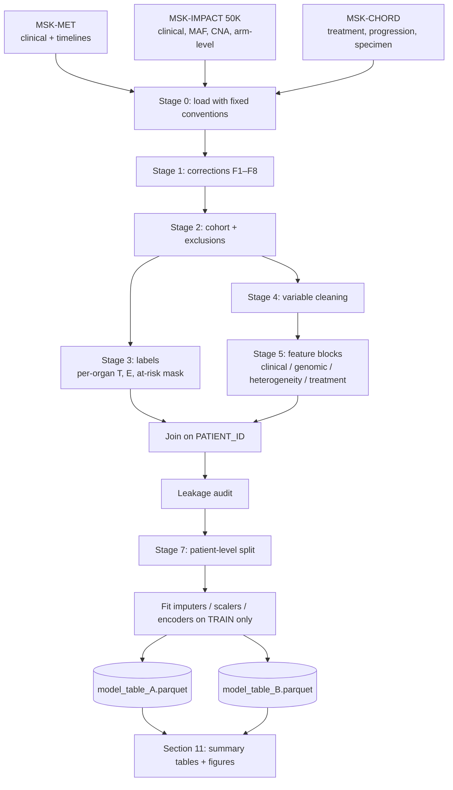

# Data Cleaning and Preprocessing Plan

**Project:** Predicting metastatic spread (and, exploratorily, subclone persistence) from genomic, clinical and treatment data
**Data:** MSK-MET 2021, MSK-IMPACT 50K 2026, MSK-CHORD 2024 (cBioPortal exports in `data/raw/`)
**Builds on:** `data/data_exploration.ipynb`, `data/loaders.py`, `data/build_features.py`, `Data Cleaning.pdf`

All numbers in this plan come from checks run against the raw files and the current
`data/derived/*.parquet`. Numbers marked *expected* are estimates of what the corrected
pipeline should produce; the pipeline should reproduce them (within a small tolerance) and
the summary outputs in [Section 11](#11-summary-tables-and-visualizations-generated-at-the-end) report the actual values.

---

## Contents

1. [Scope and modelling decisions this plan assumes](#1-scope-and-modelling-decisions-this-plan-assumes)
2. [Pipeline overview](#2-pipeline-overview)
3. [Stage 0: Loading conventions](#3-stage-0-loading-conventions)
4. [Stage 1: Corrections to the existing pipeline](#4-stage-1-corrections-to-the-existing-pipeline)
5. [Stage 2: Cohort definition and exclusions](#5-stage-2-cohort-definition-and-exclusions)
6. [Stage 3: Label construction](#6-stage-3-label-construction)
7. [Stage 4: Variable-level cleaning](#7-stage-4-variable-level-cleaning)
8. [Stage 5: Feature engineering](#8-stage-5-feature-engineering)
9. [Stage 6: Missing data](#9-stage-6-missing-data)
10. [Stage 7: Splitting and leakage-safe transforms](#10-stage-7-splitting-and-leakage-safe-transforms)
11. [Summary tables and visualizations generated at the end](#11-summary-tables-and-visualizations-generated-at-the-end)
12. [Validation checklist](#12-validation-checklist)
13. [Open decisions for the team](#13-open-decisions-for-the-team)

---

## 1. Scope and modelling decisions this plan assumes

These follow from the exploration notebook and are taken as settled here. If the team
changes one of them, the affected stages are noted.

| Decision | Choice | Why | Affects |
|---|---|---|---|
| Unit of analysis | One row per patient: the MSK-MET sample | MSK-MET has exactly one sample per patient and holds the labels | All |
| Time zero | Sequencing date of that MSK-MET sample | Only point at which genomic features are known | Stages 1, 3, 5 |
| Primary target | Per-organ time to **new** distant metastasis after sequencing, with censoring | Two-thirds of recorded metastases predate the biopsy; predicting them is detection, not prediction | Stage 3 |
| Secondary target | Time to radiographic progression (MSK-CHORD NLP), five cancer types only | Real clinical endpoint absent from MSK-MET | Stage 3 |
| Task 1 (subclone survival) | Exploratory side analysis only | Only 893 Primary→Metastasis pairs carry MSK-MET labels, 90 of them dated | Section 13 |
| Configurations | **A:** pan-cancer, no treatment (27 types). **B:** treatment-aware (5 MSK-CHORD types) | MSK-CHORD covers only NSCLC, colorectal, breast, prostate, pancreatic | Stages 2, 5 |

Both configurations are built from the same cleaned table; B is a filtered subset with the
treatment block added.

---

## 2. Pipeline overview



**Proposed file layout** (extends the existing `data/` folder):

```
data/
  loaders.py              # Stage 0 (exists; F1 edits the organ map)
  build_features.py       # Stages 1–5 (exists; F2–F8 edits)
  preprocess.py           # NEW: Stages 6–7 (split, impute, encode, scale)
  report.py               # NEW: Section 11 tables + figures
  derived/
    cohort.parquet         # one row per patient, raw-ish features + labels
    labels.parquet         # NEW: long format (PATIENT_ID, organ, T, E, at_risk)
    het_features.parquet
    treatment.parquet
    genomic_features.parquet   # NEW: gene-level + arm-level block
    model_table_A.parquet      # NEW: final, with split column
    model_table_B.parquet      # NEW
  reports/                 # NEW: Section 11 outputs (csv + png)
```

---

## 3. Stage 0: Loading conventions

These are already implemented in `loaders.py` and should stay as the single source of truth.

| Convention | Rule |
|---|---|
| Clinical files | `skiprows=4`; row 5 is the header |
| Large files | Always pass `usecols` (`data_mutations.txt` 190 MB, `data_CNA.ascna.txt` 103 MB) |
| IDs | `PATIENT_ID` = `P-XXXXXXX`; `SAMPLE_ID` = `P-XXXXXXX-TNN-IMN`; join across studies directly |
| MSK-MET time | Days since birth, re-anchored with `anchor_met_to_sequencing()` to days from sequencing |
| MSK-CHORD time | Days since patient's *first* sequencing (see F6: not always the MSK-MET sample) |
| Dates | Keep as **integer day offsets**. Do not convert to `datetime`; the data are de-identified and have no calendar dates |
| Mixed-type columns | Coerce numerics explicitly with `pd.to_numeric(..., errors="coerce")` (e.g. `t_ref_count` contains strings) |

---

## 4. Stage 1: Corrections to the existing pipeline

Each fix lists the problem, the evidence, the change, and an assertion to add so the problem
cannot come back.

### F1. Regional lymph nodes are labelled as distant metastases

- **Where:** [`loaders.py:69`](data/loaders.py#L69), `TIMELINE_SUBTYPE_TO_ORGAN`
- **Problem:** `Regional Lymph` (15,154 events) and generic `Lymph` (6,696) map to `DIST_LN`.
  Regional nodal spread is not distant metastasis.
- **Evidence:** of 5,087 post-sequencing `DIST_LN` events, only 3,004 have
  `DMETS_DX_DIST_LN = Yes`. The MSK-MET curators do not count regional nodes as distant.
  494 patients' only "new metastasis" is a lymph-node record.
- **Fix:**
  ```python
  TIMELINE_SUBTYPE_TO_ORGAN = {
      ...,
      "Dist Lymph": "DIST_LN",
      # "Regional Lymph": excluded, not distant disease
      # "Lymph": excluded, ambiguous (regional vs distant); see sensitivity analysis S2
      ...
  }
  ```
- **Assert:** `not dx.SUBTYPE.isin(["Regional Lymph", "Lymph"]) | dx.organ.isna()`

### F2. `DMETS_DX_*` and related fields include future events (label leakage)

- **Problem:** the flags cover the patient's entire follow-up, not the moment of biopsy.
- **Evidence:** for liver, lung, bone and CNS, **100%** of post-sequencing events already
  have the matching `DMETS_DX_* = Yes`.
- **Fix:** move every field in the table below to a `LEAKY_COLUMNS` list and drop them from
  any feature matrix. Derive baseline metastatic status from the timeline instead (Section 6.3).

| Column(s) | Source | Why it leaks | Allowed use |
|---|---|---|---|
| `DMETS_DX_*` (21), `MET_SITE_COUNT`, `MET_COUNT` | MSK-MET sample | Cumulative over follow-up | Descriptive only |
| `AGE_AT_EVIDENCE_OF_METS` | MSK-MET patient | Can fall after sequencing | Only via timeline, if ≤ day +30 |
| `IS_DIST_MET_MAPPED` | MSK-MET sample | Derived from the above | None |
| `OS_MONTHS`, `OS_STATUS`, `AGE_AT_DEATH`, `AGE_AT_LAST_CONTACT` | MSK-MET / CHORD patient | Outcome / follow-up | Censoring and competing risk only |
| `ADRENAL_GLANDS`, `BONE`, `CNS_BRAIN`, `INTRA_ABDOMINAL`, `LIVER`, `LUNG`, `LYMPH_NODES`, `OTHER`, `PLEURA`, `REPRODUCTIVE_ORGANS` | MSK-CHORD patient | "Ever" flags | None |
| `STAGE_HIGHEST_RECORDED`, `GLEASON_HIGHEST_REPORTED`, `NUM_ICDO_DX` | MSK-CHORD patient | Highest/ever over follow-up | None (use first-reported values only if dated ≤ day 0) |
| `n_post_*`, `n_treatments`, `n_agents`, `n_classes`, `last_tx_day` | `treatment.parquet` | Include treatment given **after** the biopsy | None as baseline features |
| `E_*`, `T_*` | `cohort.parquet` | Labels | Labels only |

- **Assert:** `set(LEAKY_COLUMNS).isdisjoint(feature_columns)` in `preprocess.py`.

### F3. Already-involved organs counted as "new" metastases

- **Where:** [`build_features.py:155`](data/build_features.py#L155), `add_prospective_labels`
- **Problem:** the first post-sequencing diagnosis of an organ is counted as an event even
  when that organ was already involved before or at the biopsy.
- **Evidence:** affected share of current events: liver 27%, lung 33%, bone 29%, CNS 19%,
  distant LN 63%.
- **Fix:** per organ, define `at_risk = no event in that organ with DAYS_FROM_SEQ ≤ PERI`.
  Patients not at risk get `at_risk = 0` and are masked out of that organ's loss (not given
  `E = 0`).
  ```python
  baseline = (dx[dx.DAYS_FROM_SEQ <= PERI]
              .groupby(["PATIENT_ID", "organ"]).size().unstack().notna())
  at_risk = ~baseline.reindex(index=patients, columns=organs, fill_value=False)
  ```
- **Assert:** no row has `at_risk == 0 and E == 1`.

### F4. Sex-specific organs

- **Fix:** `OVARY`, `FEMALE_GENITAL` at risk only if `SEX == "Female"`; `MALE_GENITAL` only if
  `SEX == "Male"`. (Breast metastasis remains at risk for both sexes.)
- **Assert:** `at_risk_OVARY.sum()` among males is 0.

### F5. Follow-up and censoring edge cases

- **Where:** [`build_features.py:136`](data/build_features.py#L136)
- **Problem:** 57 patients have negative follow-up, 972 exactly zero, 236 missing; 1,729
  have ≤ 30 days and so no time at risk after the peri-biopsy window. 15 `E_ANY_MET` events
  fall after the end of recorded follow-up.
- **Check performed:** recomputing follow-up from `data_timeline_status.txt` (day precision,
  same axis) agrees with the current age-based value within 7 days for 98.9% of patients,
  so the source is fine; the fix is about exclusions and consistency.
- **Fix:**
  1. `followup_days = max(last status date, last diagnosis-timeline date) − sequencing date`,
     so an observed event can never fall after the end of follow-up.
  2. Exclude patients with missing follow-up or `followup_days ≤ PERI` (expected ≈ 1,950).
  3. Measure time at risk from day `PERI`, not day 0, or keep day 0 and left-truncate at
     `PERI`; pick one and state it.
- **Assert:** `(T > PERI).all()` and `(T <= followup_days).all()` for every organ.

### F6. MSK-CHORD day 0 is not always the MSK-MET sample

- **Problem:** CHORD dates count from the patient's first sequencing. The MSK-MET sample is
  the first IMPACT sample for 91.2% of patients, so roughly 9% of treatment and progression
  dates are offset.
- **Fix:** use `data_timeline_specimen.txt` (dated, has `SAMPLE_ID`) to compute
  `offset = START_DATE of the MSK-MET sample` and subtract it from every CHORD date for that
  patient. Patients whose MSK-MET sample is absent from the specimen timeline: keep only if
  it is their first sample (offset 0), else exclude from Configuration B.
- **Assert:** after re-anchoring, the MSK-MET sample's specimen date is 0 for every patient.

### F7. Untreated patients encoded as "treated on biopsy day"

- **Where:** [`build_features.py:204`](data/build_features.py#L204), `.fillna(0)`
- **Evidence:** all 10,355 patients with `any_pre_treatment == 0` have
  `days_last_pre_tx_to_seq == 0`.
- **Fix:** only fill count columns with 0; leave `days_last_pre_tx_to_seq` as NaN for
  untreated patients and add `tx_record_status` (Section 8.4).
  ```python
  count_cols = [c for c in out.columns if c.startswith("n_")]
  out[count_cols] = out[count_cols].fillna(0)
  ```
- **Assert:** `days_last_pre_tx_to_seq.isna()` equals `any_pre_treatment == 0`.

### F8. Heterogeneity features use mutations that failed FACETS QC

- **Where:** [`build_features.py:35`](data/build_features.py#L35)
- **Evidence:** 36,828 mutations have `ASCN.FACETS_QC_PASSED == False`; 6,441 have no
  `ASCN.CLONAL` call; 39,826 have no CCF.
- **Fix:** filter to `ASCN.FACETS_QC_PASSED == True` **before** computing CCF statistics.
  Keep `n_mutations` / TMB on all mutations (burden does not depend on FACETS).
  Also drop `ascn_purity`, which duplicates `FACETS_PURITY` (r = 0.999).
- **Assert:** het features are computed only from QC-passing mutations.

---

## 5. Stage 2: Cohort definition and exclusions

Apply in this order and record the count at each step (feeds Table T1 and Figure F1).

| Step | Rule | Current / expected n |
|---|---|---|
| 0 | MSK-MET patients | 25,775 |
| 1 | MSK-MET sample present in MSK-IMPACT 50K | 25,037 |
| 2 | `FACETS_QC == "Pass"` | 22,410 |
| 3 | Has a sequencing date in MSK-MET timeline | ≈ 22,410 |
| 4 | Follow-up present and > 30 days (F5) | *expected* ≈ 20,460 |
| 5 | `SEX` not missing (needed for F4) | *expected* ≈ 20,457 |
| **A** | **Configuration A (pan-cancer)** | ***expected* ≈ 20,460** |
| 6 | Cancer type is one of the five MSK-CHORD types | *expected* ≈ 11,950 |
| 7 | Present in MSK-CHORD and CHORD day 0 can be aligned (F6) | *to measure* |
| **B** | **Configuration B (treatment-aware)** | ***expected* ≈ 9,000–10,000** |

**Rare cancer types.** Four types have fewer than 100 patients (non-melanoma skin, cervical,
small bowel, anal; 355 patients). Keep them in Configuration A but collapse to
`CANCER_TYPE = "Other (rare)"` for encoding; exclude them from per-type evaluation.

**Not excluded, but flagged** for sensitivity analyses (Section 13): FACETS purity < 0.2
(7.7%), MSI-high (2.6%), hypermutated (> 50 mutations, 606 samples).

---

## 6. Stage 3: Label construction

### 6.1 Per-organ prospective labels (primary target)

Long format, one row per (patient, organ), written to `labels.parquet`:

| Column | Definition |
|---|---|
| `T` | Days from sequencing to first diagnosis in that organ with `DAYS_FROM_SEQ > PERI`; else `followup_days` |
| `E` | 1 if such a diagnosis exists, else 0 |
| `at_risk` | 1 if the organ was not involved by day `PERI` (F3) and sex-eligible (F4) |
| `competing_death` | 1 if the patient died without an event in that organ (for competing-risk models) |

**Organ set.** 20 specific organs after F1 (`UNSPECIFIED` kept separate). Expected label
counts after all fixes, Configuration A:

| Organ | Events (current) | At risk (*expected*) | Events (*expected*) | Excluded as already involved | Event rate |
|---|---:|---:|---:|---:|---:|
| LUNG | 3,302 | 16,089 | 2,199 | 4,371 | 13.7% |
| LIVER | 2,662 | 15,186 | 1,933 | 5,274 | 12.7% |
| BONE | 2,617 | 16,466 | 1,856 | 3,994 | 11.3% |
| DIST_LN | 5,087 | 17,280 | 1,833 | 3,180 | 10.6% |
| INTRA_ABDOMINAL | 1,970 | 17,083 | 1,637 | 3,377 | 9.6% |
| PNS | 1,115 | 19,979 | 1,106 | 481 | 5.5% |
| PLEURA | 1,284 | 18,678 | 1,103 | 1,782 | 5.9% |
| CNS_BRAIN | 1,337 | 19,099 | 1,080 | 1,361 | 5.7% |
| BILIARY_TRACT | 980 | 19,129 | 896 | 1,331 | 4.7% |
| BOWEL | 1,009 | 18,632 | 797 | 1,828 | 4.3% |
| ADRENAL_GLAND | 855 | 19,664 | 717 | 796 | 3.6% |
| BLADDER_UT | 559 | 19,413 | 454 | 1,047 | 2.3% |
| SKIN | 481 | 19,775 | 420 | 685 | 2.1% |
| FEMALE_GENITAL | 433 | 9,499 | 360 | 1,382 | 3.8% |
| KIDNEY | 388 | 20,092 | 361 | 368 | 1.8% |
| MEDIASTINUM | 348 | 20,021 | 314 | 439 | 1.6% |
| OVARY | 268 | 10,271 | 201 | 610 | 2.0% |
| MALE_GENITAL | 200 | 9,037 | 185 | 541 | 2.0% |
| BREAST | 135 | 20,335 | 130 | 125 | 0.6% |
| HEAD_NECK | 128 | 20,268 | 116 | 192 | 0.6% |
| *UNSPECIFIED* | 3,554 | 9,776 | 2,335 | 10,684 | *not a target* |

**Organ inclusion rule (proposed):** model an organ individually if it has ≥ 300 events in
the training split; otherwise pool into `OTHER_DISTANT`. On the expected counts and a 70%
training split (≥ ~430 total events), that keeps 12 organs individually (lung through
bladder/urinary tract).

### 6.2 Any-new-organ label

`E_ANY_NEW = 1` if any specific organ (excluding `UNSPECIFIED`) that was at risk has an
event. *Expected:* 7,799 events, against 9,823 for the current `E_ANY_MET`.

### 6.3 Baseline metastatic status (a feature, not a label)

`mets_at_baseline = any organ involved with DAYS_FROM_SEQ ≤ PERI`, plus
`n_organs_at_baseline`. *Expected:* 13,838 of 20,460 patients metastatic at baseline.
Cross-check against `DISEASE_STATUS` (12,970 "Metastasis"); report the confusion matrix
(Table T5) and investigate large disagreement before choosing which to use.

### 6.4 Progression (secondary target, Configuration B)

From `data_timeline_progression.txt`, after F6 re-anchoring:

1. Keep `PROGRESSION == "Y"` with `NLP_PROGRESSION_PROBABILITY ≥ 0.8`.
2. Resolve same-day conflicts (5.0% of patient-days): the highest probability call wins;
   ties → `Indeterminate` (dropped).
3. Event = first resolved `Y` with day > `PERI`. Censor at last progression assessment
   or last follow-up, whichever is earlier (not at death or `OS_MONTHS`, since no imaging
   means no chance to observe progression).
4. Sensitivity: thresholds 0.5 and 0.9; "two concordant Y calls within 90 days".

**Do not use** `data_timeline_tumor_sites.txt` as a label (32–63% agreement with MSK-MET;
heavily over-calls).

---

## 7. Stage 4: Variable-level cleaning

| Variable | Issue found | Action |
|---|---|---|
| `PRIMARY_SITE`, `METASTATIC_SITE` (biopsy site) | Free text; 45 / 37 case-or-whitespace duplicates; 318 / 301 values after normalising | `normalize_site()`, then hand map to the 23-value MSK-MET site vocabulary; unmapped → `"Other"`. Save the map as `site_map.csv` so it can be reviewed |
| `CANCER_TYPE`, `ORGAN_SYSTEM`, `SUBTYPE` | Clean controlled vocabulary | Keep; collapse types with < 100 patients |
| `CANCER_TYPE_DETAILED`, `ONCOTREE_CODE` | High cardinality | Keep for grouping/stratification only; do not one-hot |
| `SAMPLE_TYPE` | Biopsy site, not disease state | Keep as feature (`Primary` / `Metastasis` / `Local Recurrence`) |
| `DISEASE_STATUS` | `Unknown` 212 | Map to NaN; compare with timeline baseline status (6.3) |
| `RACE` | Hidden missing values: "Pt refused to answer" 768, "No value entered" 340, "Unknown" 86, null 62 | Map all to `"Unknown"`; collapse groups with < 100 into `"Other"` |
| `SEX` | 3 missing | Exclude (needed for F4) |
| `MSI_TYPE` | "Do not report" 2,232, "Indeterminate" 635 | Map to NaN; keep `MSI_SCORE` as the continuous feature |
| `FACETS_WGD` | Stored as object (True/False/None) | Cast to nullable boolean |
| `DMETS_DX_*` | "Yes"/"No" strings | Cast to boolean, but they are leaky (F2) |
| `HLA_*_LOH` (6) | 35–39% missing | Collapse to `any_hla_loh` (nullable) plus missing indicator |
| `GENE_PANEL` | IMPACT341 / 410 / 468 | Keep as categorical covariate |
| `FACETS_SUITE_VERSION`, `SOMATIC_STATUS`, `FACETS_QC` | Constant or used for filtering | Drop after filtering |
| `TUMOR_PURITY` (pathology) vs `FACETS_PURITY` | Two purity estimates | Keep `FACETS_PURITY` (consistent with CCF); keep pathology purity only for QC plots |
| `t_ref_count`, `t_alt_count` | Contain strings | `pd.to_numeric(errors="coerce")` |
| Treatment `AGENT` | 245 values, no case duplicates | Keep; map to class via `SUBTYPE` |

**Duplicates.** The current cohort has no duplicate `SAMPLE_ID` or `PATIENT_ID`. Keep both
uniqueness checks as assertions. Patients with several IMPACT samples matter for splitting
(Section 10), not deduplication.

**Outliers.** Do not delete. Use `log1p` for `TMB_SCORE`, `MSI_SCORE` and mutation counts;
winsorise nothing by default. CCF lies within [0, 1] (no values > 1 found).

---

## 8. Stage 5: Feature engineering

Every feature must be measurable at or before day `PERI`. Organise features into named
blocks so the heterogeneity hypothesis can be tested by adding or removing a block.

### 8.1 Clinical block (C)

`AGE_AT_SEQUENCING`, `SEX`, `RACE` (collapsed), `CANCER_TYPE` (collapsed), `ORGAN_SYSTEM`,
`SAMPLE_TYPE`, `biopsy_site` (normalised), `mets_at_baseline`, `n_organs_at_baseline`,
per-organ `baseline_<organ>` indicators (these are features *and* define the at-risk mask).

### 8.2 Genomic baseline block (G), the "simpler genomic baseline"

| Feature | Notes |
|---|---|
| `FGA` | Strongest single metastatic-burden correlate in the notebook; must be in the baseline |
| `arm_altered_fraction`, `arms_gain`, `arms_loss` | From `data_armlevel_cna.txt` |
| `log1p(TMB_SCORE)` | Use instead of `n_mutations` (ρ = 0.99, and TMB is normalised for panel size) |
| `MSI_SCORE` | Continuous |
| `FACETS_WGD`, `FACETS_PLOIDY` | |
| `FACETS_PURITY` | Covariate (affects CCF reliability) |
| `GENE_PANEL` | Covariate |
| Gene-level mutation flags | Binary per gene, nonsynonymous variants only. **Restrict to genes on all panels (the IMPACT341 set)** so older samples are not falsely wild-type. Keep genes mutated in ≥ 1% of the training split |
| Gene-level CNA flags | From `data_cna.txt` (−2/2 = deep deletion/amplification); same gene restriction and prevalence filter |
| Structural variants | Binary per recurrent fusion partner gene, ≥ 0.5% prevalence |

The IMPACT341 gene list is not in the downloaded files; get it from the cBioPortal gene
panel endpoint (`/api/gene-panels/IMPACT341`) and save it as `data/raw/impact341_genes.txt`.

### 8.3 Heterogeneity block (H)

Computed from QC-passing mutations only (F8).

| Feature | Keep? | Notes |
|---|---|---|
| `subclonal_fraction` | Yes | Main heterogeneity index |
| `n_determinate` | Yes | Confidence weight; 9.2% of samples have k = 1 |
| `ccf_std` **or** `math_score` | One of them | Mutually redundant (ρ 0.59–0.77) with `ccf_mean`; pick by train-split stability |
| `ccf_mean`, `ccf_median`, `ccf_min` | Drop for linear models | Keep at most one for tree models |
| `het_reliable` | Yes | `n_determinate ≥ 5` and `FACETS_PURITY ≥ 0.2` |
| `has_mutations` | Yes | 0 for the 622 zero-mutation samples |

### 8.4 Treatment block (T), Configuration B only

Built from the F6-re-anchored, F7-fixed treatment table, with **pre-sequencing events only**
(`START_DATE < −PERI`, including regimens still ongoing at sequencing).

| Feature | Encoding |
|---|---|
| `tx_record_status` | `treated_pre` / `no_pre_tx_in_record` / `no_chord_record` (missing ≠ untreated) |
| `PRIOR_MED_TO_MSK` | Treatment before arriving at MSK (from CHORD patient file) |
| `pre_<class>` | Binary per drug class (Chemo, Hormone, Targeted, Biologic, Immuno, Investigational, Bone) |
| `pre_<agent>` | Binary per agent for agents with ≥ 500 patients within a cancer type; the rest roll up to their class |
| `n_pre_lines` | Count of distinct pre-sequencing regimens |
| `days_last_pre_tx_to_seq` | NaN if untreated, plus indicator |
| `on_treatment_at_seq` | Regimen spans day 0 |

Post-sequencing treatment is not a baseline feature. If the team later models "treatment
received" as an intervention, it needs a time-varying model, not a static column.

---

## 9. Stage 6: Missing data

| Kind of missingness | Examples | Strategy |
|---|---|---|
| **Structural:** not applicable | CCF features when there are no mutations; `days_last_pre_tx_to_seq` when untreated | Do not impute. Fill with a neutral value (0 or median) **and** add an indicator; tree models can take NaN directly |
| **Informative:** missing for a reason | `AGE_AT_DEATH` (alive); treatment record absent | Encode explicitly as a category or flag; never drop rows |
| **Disguised:** text meaning "missing" | `RACE` "Pt refused…", `MSI_TYPE` "Do not report" | Convert to NaN / "Unknown" in Stage 4 |
| **At random** (small) | `FACETS_PURITY` (~0.1%), `FGA` | Median (numeric) or mode (categorical) imputation **fit on the training split**; add an indicator if > 1% missing |
| **Large blocks** | HLA LOH 35–39% | Collapse + indicator (Stage 4); drop if it adds nothing in validation |

**Column-drop rule:** drop a feature only if it is > 50% missing **and** its missingness
indicator carries no signal in the training split (univariate check against `E_ANY_NEW`).
Regression or iterative imputation (as suggested in `Data Cleaning.pdf`) is acceptable for
the "at random" group, fitted within each cross-validation fold.

---

## 10. Stage 7: Splitting and leakage-safe transforms

1. **Split first, transform second.** Assign `split ∈ {train, val, test}` (70/15/15) before
   any imputation, scaling, encoding or gene-prevalence filtering.
2. **Group by patient.** One row per patient already, but enforce `GroupKFold` /
   `StratifiedGroupKFold` on `PATIENT_ID` so any later multi-sample extension stays safe.
3. **Stratify** on `CANCER_TYPE × E_ANY_NEW` so rare types and events appear in every split.
4. **Freeze the test set.** Save split assignments to `derived/splits.csv` with a fixed seed;
   never refit on it.
5. **Fit on train only:** imputers, `StandardScaler` (continuous features), one-hot or target
   encoding (categoricals; target encoding inside folds only), gene prevalence filters.
   Wrap them in a single `sklearn` `ColumnTransformer` pipeline and persist it with `joblib`.
6. **Optional temporal check:** train on IMPACT341 + IMPACT410, test on IMPACT468, to measure
   sensitivity to panel or era drift.

---

## 11. Summary tables and visualizations generated at the end

`data/report.py` runs after the pipeline and writes everything below to `data/reports/`.
These outputs are the deliverable that shows the cleaning worked, and they double as the
methods figures for the write-up.

### Tables (CSV, rendered as markdown in the report)

| ID | Table | Contents | Purpose |
|---|---|---|---|
| **T1** | Cohort attrition | n at each step in Section 5, for A and B | CONSORT-style flow; shows who was lost and why |
| **T2** | Cohort characteristics ("Table 1") | Age, sex, race, cancer type, sample type, baseline metastatic status, panel, purity, FGA, TMB, follow-up; by configuration and by split | Shows train/val/test balance |
| **T3** | Label summary | Per organ: at risk, events, event rate, median time to event, events excluded as already involved, pooled vs individual | Replaces the expected table in 6.1 with actual values |
| **T4** | Before/after corrections | Per organ: events under the old pipeline vs the corrected one, broken down by fix (F1, F3, F4, F5) | Documents the effect of each fix |
| **T5** | Baseline status agreement | Confusion matrix of timeline-derived `mets_at_baseline` vs `DISEASE_STATUS` | Validates 6.3 |
| **T6** | Data dictionary | Every final feature: block (C/G/H/T), type, source file/column, transform, % missing, imputation, train-split mean/SD or levels | Reproducibility |
| **T7** | Leakage audit | Every source column → kept / dropped / label-only, with reason; plus result of the automated check | Proves F2 is enforced |
| **T8** | Missingness | % missing per feature, before and after imputation, by configuration | Supports Section 9 |
| **T9** | Value-mapping log | Raw → cleaned values for `RACE`, `MSI_TYPE`, biopsy site, cancer-type collapsing, with counts | Audit trail for Stage 4 |

### Figures (PNG, 150 dpi, reuse `viz.py` theme)

| ID | Figure | Chart type | What it should show |
|---|---|---|---|
| **F1** | Cohort flow | Horizontal bar / flow diagram from T1 | Where patients drop out |
| **F2** | Effect of label corrections | Paired horizontal bars per organ (old vs corrected events) | Size of F1/F3 correction; DIST_LN should shrink most |
| **F3** | Event rate and at-risk size per organ | Dot plot, organs sorted by events, ≥ 300-event threshold marked | Which organs are modelled individually vs pooled |
| **F4** | Time to new metastasis | Kaplan–Meier (1 − S) for top organs, faceted by the 5 largest cancer types | Sanity check against known tropism (e.g. colorectal → liver, prostate → bone) |
| **F5** | Follow-up distribution | Histogram with the 30-day exclusion line and median | Censoring burden after the fix |
| **F6** | Missingness map | Heatmap: feature (rows, grouped by block) × cancer type (cols), % missing | Whether missingness clusters by cancer type |
| **F7** | Feature distributions before/after transform | Small multiples for TMB, MSI score, FGA, subclonal fraction, purity | Effect of log/scaling; no leftover extreme values |
| **F8** | Final feature correlation | Spearman heatmap of continuous features (block-ordered) | No redundant pairs left (|ρ| > 0.9) |
| **F9** | Split balance | Grouped bars: cancer-type share and event rate per split | Stratification worked |
| **F10** | Heterogeneity reliability | `subclonal_fraction` vs `n_determinate`, coloured by `het_reliable` | Fraction of the cohort where H features are trustworthy |

Suggested `report.py` skeleton:

```python
from pathlib import Path
import pandas as pd
import loaders as L, viz

OUT = L.DATA_DIR / "reports"; OUT.mkdir(exist_ok=True)

def save_table(df: pd.DataFrame, name: str) -> None:
    df.to_csv(OUT / f"{name}.csv")
    (OUT / f"{name}.md").write_text(df.to_markdown())

def main() -> None:
    A = pd.read_parquet(L.DERIVED / "model_table_A.parquet")
    labels = pd.read_parquet(L.DERIVED / "labels.parquet")
    attrition = pd.read_csv(L.DERIVED / "attrition.csv")
    save_table(attrition, "T1_attrition")
    save_table(label_summary(labels), "T3_labels")
    ...
    fig_label_corrections(labels).savefig(OUT / "F2_label_corrections.png", dpi=150)
    ...

if __name__ == "__main__":
    main()
```

Finally, `report.py` should write `reports/README.md`, which embeds every table and figure
in order, so the team has one page to review after each pipeline run.

---

## 12. Validation checklist

Run as `assert`s at the end of `build_features.py` / `preprocess.py`; the pipeline fails
rather than writing bad data.

- [ ] `PATIENT_ID` and `SAMPLE_ID` unique in the cohort
- [ ] No `Regional Lymph` / `Lymph` event mapped to an organ (F1)
- [ ] `LEAKY_COLUMNS ∩ feature_columns = ∅` (F2)
- [ ] No row with `at_risk == 0` and `E == 1` (F3)
- [ ] No sex-specific organ at risk for the other sex (F4)
- [ ] `PERI < T ≤ followup_days` for all at-risk rows; no missing `T` (F5)
- [ ] MSK-MET sample's re-anchored specimen date is 0 for all Configuration B patients (F6)
- [ ] `days_last_pre_tx_to_seq` is NaN exactly when there is no pre-sequencing treatment (F7)
- [ ] Het features computed only from `ASCN.FACETS_QC_PASSED == True` mutations (F8)
- [ ] All treatment features use `START_DATE < −PERI` only
- [ ] No feature has |Spearman ρ| > 0.95 with another feature
- [ ] Transformers were fitted on train rows only (check fitted `n_samples_seen_`)
- [ ] Split proportions within ±1% of target; every cancer type with ≥ 100 patients present in every split
- [ ] Organ event counts within ±5% of the expected table in 6.1 (or the difference explained)

---

## 13. Open decisions for the team

| # | Decision | Options | Recommendation |
|---|---|---|---|
| D1 | Generic `Lymph` subtype | Drop / treat as distant / sensitivity analysis | Drop in the main analysis; sensitivity analysis S2 |
| D2 | Time origin for risk | Day 0 with events counted after day 30, or left-truncate at day 30 | Left-truncate at day 30 (cleanest for survival models) |
| D3 | Competing risk of death | Ignore (cause-specific) / Fine–Gray | Cause-specific in the main model; report death counts per organ |
| D4 | Baseline metastatic status source | Timeline-derived vs `DISEASE_STATUS` | Timeline-derived, after reviewing T5 |
| D5 | Organ pooling threshold | 200 / 300 / 500 training events | 300 |
| D6 | Task 1 (subclone persistence) | Drop / small exploratory analysis on 893 paired patients | Exploratory only; descriptive comparison of CCF in Primary vs Metastasis pairs, no survival claim |

**Sensitivity analyses** to plan for (not part of the main pipeline):

- **S1:** exclude low-purity (< 0.2), MSI-high and hypermutated samples.
- **S2:** include generic `Lymph` as `DIST_LN`.
- **S3:** progression-threshold variants (Section 6.4).
- **S4:** include FACETS-QC-failing samples with the H block masked, to estimate QC selection bias.
- **S5:** treatment-naive subgroup only (cleanest test of the heterogeneity hypothesis).
